# Visual evidence from the experiments

Detailed historical sources named without links are retained in the local archive.

Thirteen unchanged source figures, preserved on 29 October 2026. These pictures show both partial progress and the scale of the remaining problems. Click a figure to open its full resolution. The [history](EXPERIMENT_HISTORY.md) gives the experiment sequence.

Figures 1–8 are the existing retrospective panels: SPX 29/211 days and VIX 27/153 days are representative displays, not reductions of fitting scope. Market points and bid–ask shading, own-model-forward native IVs, unavailable-IV ticks and their conventions follow the original report. Model uncertainty bands were omitted there for readability. Figures 9–13 retain the later original all-maturity plots. All comparisons are exploratory; losses and baselines differ between studies.

## Curve and cap

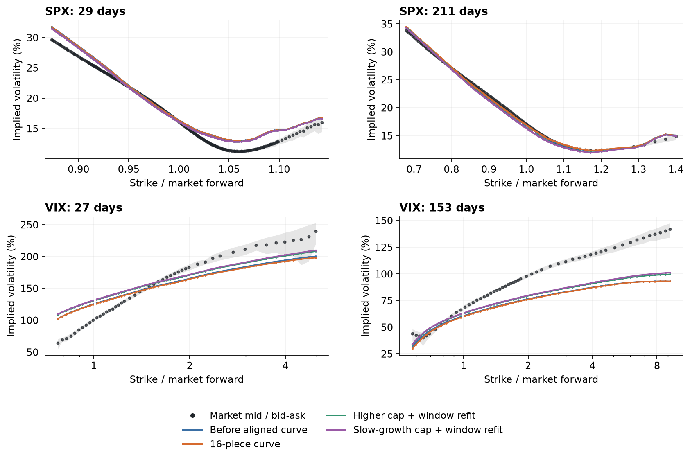

**Figure 1.** Easing the cap can raise VIX wing levels while damaging SPX. The cap comparisons also adjust four VIX-window curve levels, so they do not isolate the cap alone. Training ensembles; fresh aggregate cap gains were smaller than one paired SE.

Sources: `MATURITY_CURVE_FIT_RESULTS.md`, `CAP_CONTROLLED_RESULTS.md`. Original image: [01-curve-cap.png](../../output/pdf/concise/figures/01-curve-cap.png).

## Stochastic response

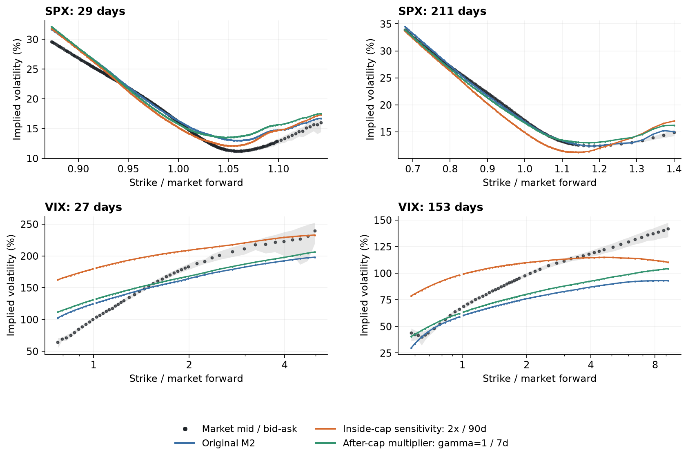

**Figure 2.** Inside-score and after-cap randomness change both tail response and normalization. Placement, form and persistence differ in these selections. Neither fixed-curve test solved the joint fit.

Sources: `STOCHASTIC_VOV_RESULTS.md`, `POSTCAP_VOV_RESULTS.md`. Original image: [02-stochastic-response.png](../../output/pdf/concise/figures/02-stochastic-response.png).

## Two stress speeds

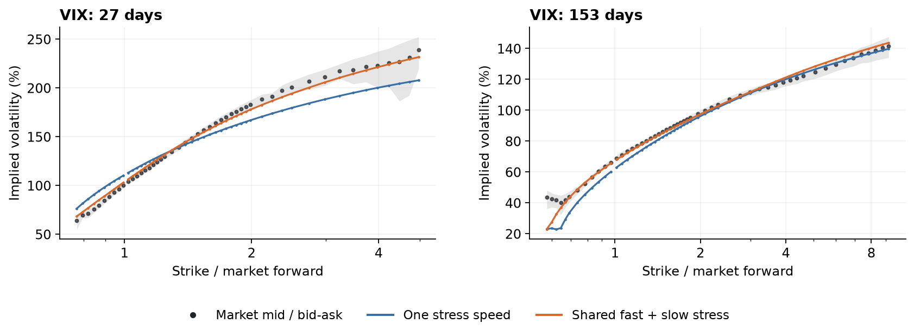

**Figure 3.** The orange curve is substantially closer to VIX quotes at both displayed maturities. The full fit used all four maturities; checking loss fell 1.725555 to 0.050081. This trial did not price SPX. Checking partly reused old/slow states.

Sources: `TWO_SPEED_RESULTS.md`. Original image: [03-two-speeds.png](../../output/pdf/concise/figures/03-two-speeds.png).

## Joint refit tradeoff

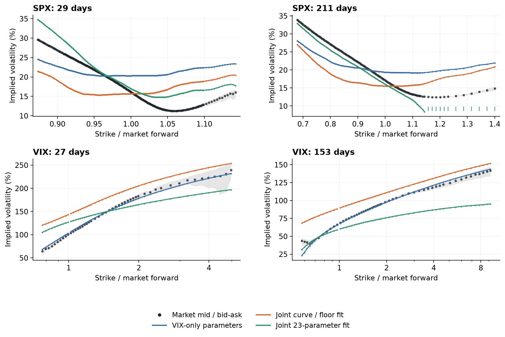

**Figure 4.** Fitting both markets improved sampled SPX prices while largely losing the VIX wing fit. The optimizer sharply reduced the successful stress weight. These original 64-step stock comparisons are exploratory, not continuous-model limits.

Sources: `TWO_SPEED_JOINT_RESULTS.md`. Original image: [04-joint-tradeoff.png](../../output/pdf/concise/figures/04-joint-tradeoff.png).

## Protected curve

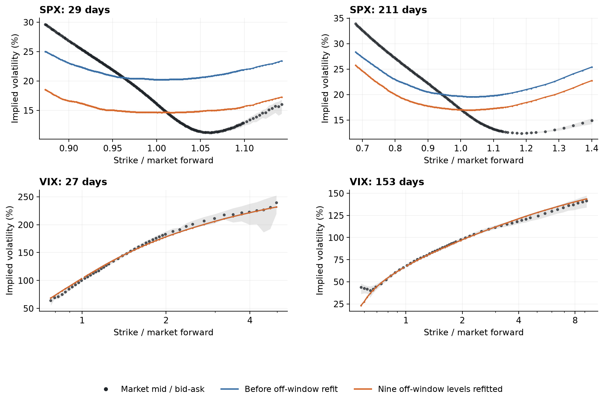

**Figure 5.** Changing only the nine off-window variance levels preserves the model VIX law, yet does not repair SPX skew. The lower price loss accompanies worse aggregate native-IV error. VIX curves reuse inherited prices.

Sources: `PROTECTED_CURVE_RESULTS.md`. Original image: [05-protected-curve.png](../../output/pdf/concise/figures/05-protected-curve.png).

## Stock and stress correlation

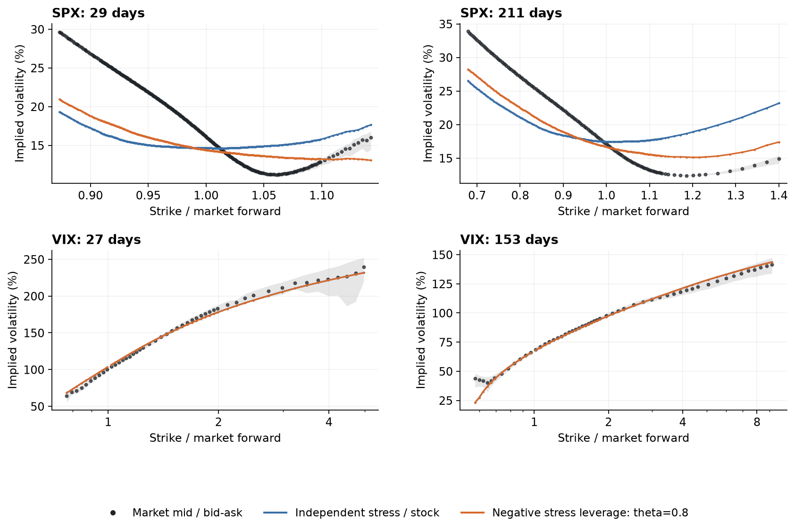

**Figure 6.** Negative stock/stress correlation tilts SPX in the useful direction while VIX curves overlap exactly. The left SPX wing remains too low. Selected theta=0.8, 128 stock steps/day; auxiliary reference samples were reused.

Sources: `LEVERAGE_SCAN_RESULTS.md`. Original image: [06-negative-correlation.png](../../output/pdf/concise/figures/06-negative-correlation.png).

## Asymmetric readout

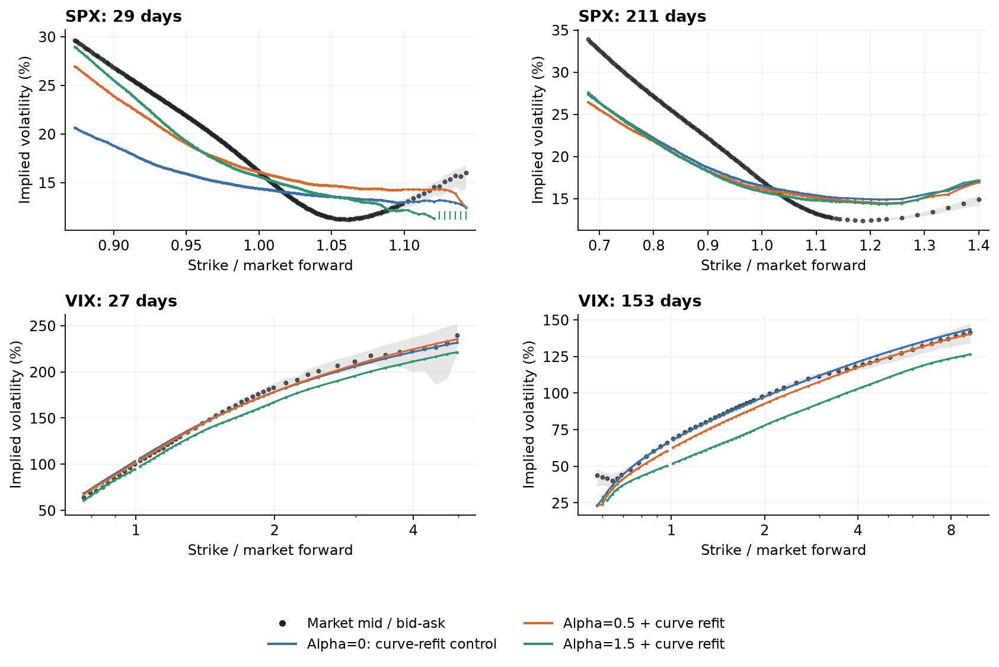

**Figure 7.** A stronger downside response can help SPX while damaging VIX. Mean-one normalization changes effective stress allocation; the displayed comparison includes a curve refit.

Sources: `ASYMMETRIC_READOUT_RESULTS.md`. Original image: [07-asymmetric-readout.png](../../output/pdf/concise/figures/07-asymmetric-readout.png).

## Slower existing signal

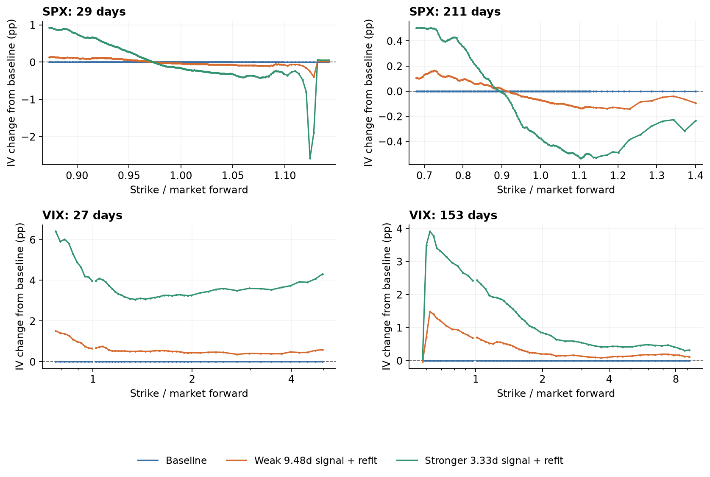

**Figure 8.** These panels show IV changes rather than smile levels. A weak slower signal moves SPX modestly; stronger settings cost more VIX fit. Selection and strength differ in the strong contrast. New target draws with reused reference anchors.

Sources: `SLOW_READOUT_RESULTS.md`. Original image: [08-slower-signal.png](../../output/pdf/concise/figures/08-slower-signal.png).

## Linear memory filters

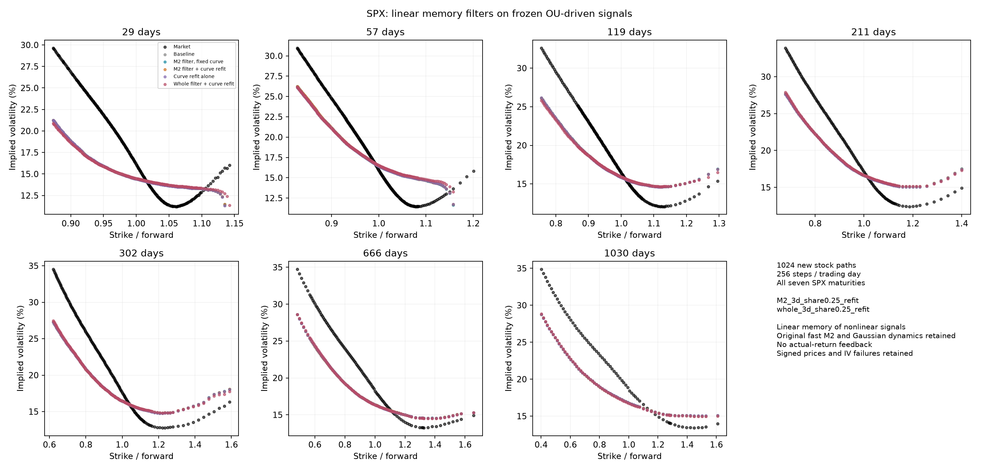

**Figure 9.** Across all seven SPX maturities the tested filter curves barely separate and the missing downside-IV level remains visible. 1024 new stock paths, 256 steps/day, reused auxiliary reference. The completed study found no material improvement.

Sources: `MEMORY_FILTER_RESULTS.md`. Original image: `SPX-memory-filter.png`.

## Linear filters and VIX

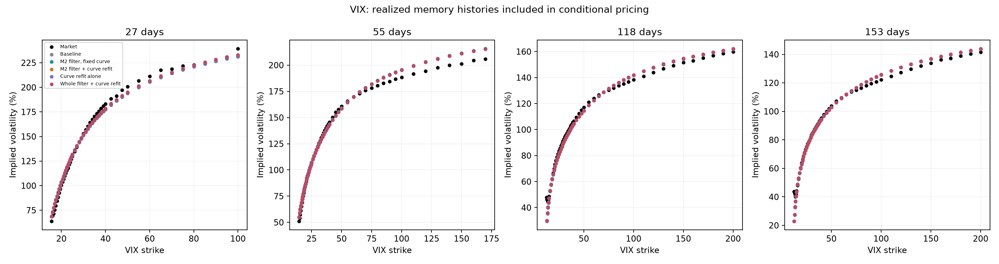

**Figure 10.** The companion VIX panels show the distributional cost that cannot be inferred just from mean-one filtering or fitted forwards. Retain all four maturities and the unavailable-IV gaps.

Sources: `MEMORY_FILTER_RESULTS.md`. Original image: `VIX-memory-filter.png`.

## Protected variance corrections

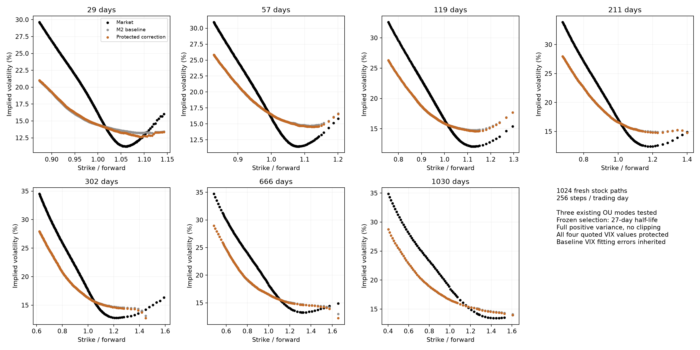

**Figure 11.** The first bounded correction changes stock-path variance with analytical quoted-date VIX protection. The SPX improvement is small relative to the market gap. Positivity guarantees f/2, rather than the original f.

Sources: `PROTECTED_VARIANCE_RESULTS.md`. Original image: `SPX-protected-variance.png`.

## Richer protected shapes

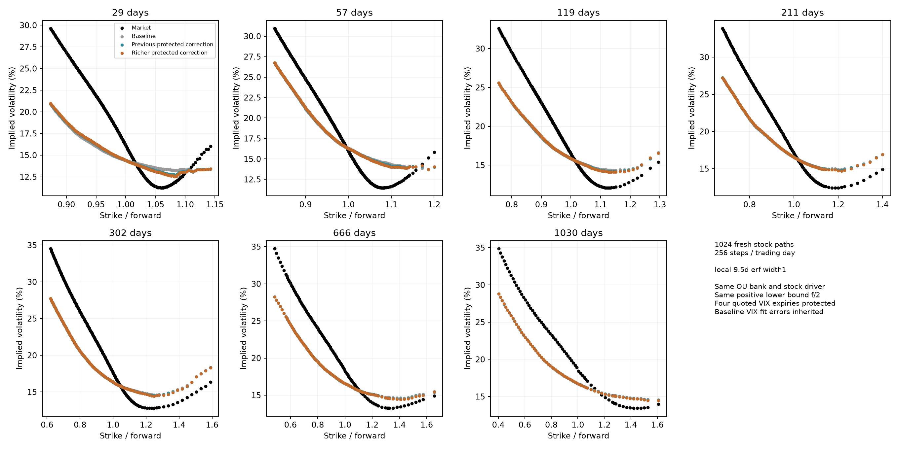

**Figure 12.** Local time envelopes and richer state shapes give a modest additional SPX gain, still far from market downside skew. Different checking samples prevent direct absolute-loss comparisons with the preceding figure.

Sources: `RICH_PROTECTED_VARIANCE_RESULTS.md`. Original image: `SPX-rich-protected.png`.

## Existing stress variance budget

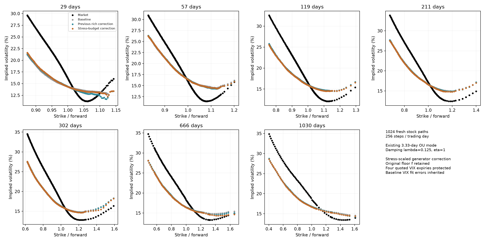

**Figure 13.** The latest stress-scaled correction retains the original floor and can exceed the old absolute budget. Its seven-maturity smiles still miss downside levels. Paired uncertainty intervals include zero improvement; at 29 days downside IV is about 19.26% versus 26.90% market.

Sources: `AVAILABLE_VARIANCE_RESULTS.md`. Original image: `SPX-available-variance.png`.

The `figure provenance manifest` records source paths and SHA-256 hashes. Figures 1–8 also retain their original [panel inputs and diagnostics](../../output/pdf/concise) there. No simulation, IV calculation or image alteration was performed for this gallery.
