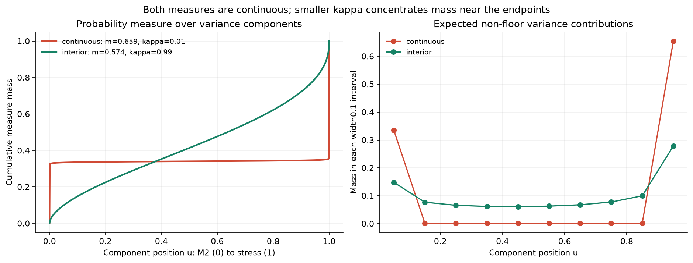

# Empirical reduction of a continuous M2 stress mixture

The general integral model contains the simpler M2/stress mixture as a special case. In the calibration studied here, allowing a continuous range of intermediate components did not improve the fit. The best tested continuous density placed approximately 99% of its measure near the two endpoints. This supports retaining the simpler two-component model for this dataset while preserving the integral formulation for future market conditions.

This is an empirical reduction within a specified model family and bounded numerical search. It is not a theorem that two components always suffice, and it does not establish that the current VIX smiles are fully fitted.

## 1 What a variance component represents

Let $v_t$ be instantaneous stock variance. If volatility is 20%, variance is $0.20^2=0.04$. Let

- $\xi(t)$ be the desired expected variance at date $t$, under the pricing measure $\mathbb Q$;
- $f\geq0$ be the minimum variance, with $\xi(t)\geq f$;
- $X_t$ denote the existing M2 reservoir state.

The pricing measure is the probability measure used to value derivatives. Its probabilities should not be interpreted directly as real-world forecasts.

The old M2 response is

$$
R_t^{\mathrm{M2}}=\frac{G(X_t)}{M(t)},\qquad
M(t)=\mathbb E_{\mathbb Q}[G(X_t)].
$$

Here $G$ is the positive, smoothly capped M2 readout. More explicitly,

$$
\begin{aligned}
\eta_t&=c_C C_t+q_Y(Y_t-\beta_Y)^2+q_J(J_t-\beta_J)^2,\\
h(\eta)&=\ell-\frac1k\log\!\left(1+e^{k(\ell-\eta)}\right),\\
G(X_t)&=e^{2h(\eta_t)}.
\end{aligned}
$$

The three readout projections $C,Y,J$ come from the existing reservoir. The original dynamics, premiums and readout parameters were frozen in this experiment; in particular, $\beta_J>0$. Dividing by $M(t)$ gives $\mathbb E[R_t^{\mathrm{M2}}]=1$. Therefore

$$
v_t=f+(\xi(t)-f)R_t^{\mathrm{M2}}
$$

has expected variance $\xi(t)$. The random response changes the distribution around that expected level.

## 2 The connection with Bergomi

In [Smile Dynamics III](https://www.risk.net/media/download/920801/download), *Risk*, October 2008, pp. 91–92, Bergomi considers positive normalized measures of exponentials, then uses a practical two-exponential parametrization. His mapping parameters can also vary with maturity. This motivates our positive-mixture architecture. The capped M2/geometric interpolation below is our adaptation, not Bergomi's exact model. The two-exponential idea already appears in his paper; our empirical finding concerns which components are useful in our particular family.

Schematically, if $N$ is centred Gaussian with variance $V$,

$$
L_\lambda(N)=e^{\lambda N-\lambda^2V/2},
\qquad \mathbb E[L_\lambda(N)]=1.
$$

For a probability measure $\nu$, a positive combination

$$
H(N)=\int L_\lambda(N)\,\nu(d\lambda)
$$

also has mean one. The essential idea is to combine responses with different sensitivities while retaining positivity and normalization.

## 3 A continuous family containing the original M2 response

Introduce one independent Ornstein–Uhlenbeck stress factor:

$$
dZ_t=-aZ_t\,dt+\sqrt{2a}\,dB_t,\qquad Z_0=0.
$$

Thus

$$
q(t)=\operatorname{Var}_{\mathbb Q}(Z_t)=1-e^{-2at},
\qquad a=\frac{\log2}{\text{half-life in years}}.
$$

The independence assumption is between $Z$ and the old reservoir. For each component position $u\in[0,1]$, define

$$
\boxed{
\mathcal R_t(u)=
\frac{G(X_t)^{1-u}}{\mathbb E_{\mathbb Q}[G(X_t)^{1-u}]}
\exp\!\left(buZ_t-\frac{b^2u^2q(t)}2\right).
}
$$

The position $u$ describes a response, not a new random variable:

| Position | Response |
|---|---|
| $u=0$ | Exactly the original normalized M2 component |
| $0<u<1$ | A weaker M2 power combined with increasing stress sensitivity |
| $u=1$ | A pure normalized OU stress exponential |

All positions share the same old reservoir and the same $Z$. Using many numerical integration nodes does not introduce a separate stochastic bank for each node.

The denominator is recomputed for each power. In general, $\mathbb E[G^{1-u}]\neq\mathbb E[G]^{1-u}$. This is why the original conditional M2 expectations could not simply be reused unchanged.

For a deterministic probability measure $\mu$ on $[0,1]$, set

$$
\boxed{
v_t=f+(\xi(t)-f)\int_0^1\mathcal R_t(u)\,\mu(du).
}
$$

This is one integral. Independence and Gaussian exponential normalization give $\mathbb E[\mathcal R_t(u)]=1$. Since the weights are nonnegative and have total mass one,

$$
v_t\geq f,\qquad \mathbb E[v_t]=\xi(t).
$$

The original cap makes $G$ bounded above and strictly positive. For $0\leq1-u\leq1$, $G^{1-u}\leq\max(1,G)$; the power normalizers are therefore finite and positive.

The mass $\mu(A)$ assigned to an interval $A$ is its share of **expected non-floor variance**. It is not the probability that the market chooses one component. All components contribute simultaneously; their realized relative contributions change with the state.

## 4 How the simpler model sits inside the general one

For

$$
\mu=(1-w)\delta_0+w\delta_1,
$$

where $\delta_x$ means all mass at $x$, the integral becomes

$$
\boxed{
v_t=f+(\xi(t)-f)
\left[(1-w)R_t^{\mathrm{M2}}+
 w e^{bZ_t-b^2q(t)/2}\right].
}
$$

This is exactly the simpler two-component model. The integral formulation thus provides a parent family in which a simpler response can emerge.

The continuous densities tested were

$$
\mu(du)=\operatorname{Beta}(m\kappa,(1-m)\kappa)(du),
\qquad 0<m<1,\quad\kappa>0.
$$

For a mathematical variable $U$ distributed according to this measure,

$$
\mathbb E[U]=m,\qquad
\operatorname{Var}(U)=\frac{m(1-m)}{1+\kappa}.
$$

Large $\kappa$ concentrates mass around $m$. Small $\kappa$, with $m$ fixed away from zero and one, concentrates mass near the two endpoints, not near the mean.

In fact,

$$
\mu\ \Longrightarrow\ (1-m)\delta_0+m\delta_1
\quad\text{as }\kappa\downarrow0.
$$

An elementary way to see the endpoint concentration is

$$
\mathbb E[U(1-U)]=\frac{m(1-m)\kappa}{1+\kappa}\longrightarrow0.
$$

For any $0<\varepsilon<1/2$,

$$
\Pr(\varepsilon\leq U\leq1-\varepsilon)
\leq\frac{\mathbb E[U(1-U)]}{\varepsilon(1-\varepsilon)}
\longrightarrow0.
$$

The mean $m$ then fixes the limiting mass at the right endpoint. Here $\Pr$ describes the mathematical distribution of component positions under $\mu$, not a regime-switching probability in the market.

Here a continuous measure means an atom-free, absolutely continuous probability measure. Its density need not be bounded at the endpoints: Beta parameters below one give integrable endpoint singularities. The response family remains smooth in its component position.

A Beta density with positive $\kappa$ has no atoms. Consequently, the exact two-component model belongs to the general measure family and to the weak closure of the continuous-density family. The finite density fitted below approximates it closely; it is not literally a two-atom measure.

## 5 What the VIX calibration actually fits

In this model, a VIX option expiring at $T$ depends on variance over the **following** 30 days:

$$
\Delta=\frac{30}{365},\qquad
\operatorname{VIX}_T=
100\sqrt{\frac1\Delta\,
\mathbb E_{\mathbb Q}\!\left[\int_T^{T+\Delta}v_s\,ds
\mid\mathcal F_T\right]}.
$$

For example, the first option expiry is day 27, but its VIX variance window is days 27–57. The uncertainty evolves until day 27; the underlying VIX then looks forward another 30 days.

The conditional response used by the pricer is

$$
\mathbb E[\mathcal R_s(u)\mid\mathcal F_T]
=
\frac{\mathbb E[G(X_s)^{1-u}\mid X_T]}
     {\mathbb E[G(X_s)^{1-u}]}
\exp\!\left(
 bu e^{-a(s-T)}Z_T
 -\frac{b^2u^2e^{-2a(s-T)}q(T)}2
\right).
$$

The component integral and the future-time integral are computed before the square root and before the option payoff. Averaging finished option smiles would define a different construction.

The four forward constraints are

$$
\mathbb E_{\mathbb Q}[\operatorname{VIX}_{T_i}]=F_i^{\mathrm{market}}.
$$

They are separate from

$$
\mathbb E_{\mathbb Q}[\operatorname{VIX}_{T}^2]
=\frac{10000}{\Delta}\int_T^{T+\Delta}\xi(s)\,ds.
$$

The first equation fixes the mean VIX. The second fixes its second moment, or mean squared VIX. Their difference determines the variance of VIX. Matching either one alone does not determine the smile.

## 6 The empirical result

The stored expiry dates and times to expiry imply a pricing date of **19 February 2026**. The numerical investigation was performed on **27 October 2026**. These dates should not be confused: the experiment uses one stored market snapshot, not evidence across many market regimes.

The test retained all 217 native VIX quotes at 27, 55, 118 and 153 days. Seven independent VIX-sensitive levels of the 16-piece variance curve and the variance floor remained free. SPX fitting was paused.

| Model | Calibration option loss | Checking option loss | Checking prices inside bid–ask |
|---|---:|---:|---:|
| Previous working two-component fit | 1.781489 | 1.765844 | 82/217 |
| Refitted two-component reference | 1.733264 | 1.725555 | 83/217 |
| Best tested continuous Beta measure | 1.737660 | 1.730675 | 83/217 |
| Retained broader Beta measure | 1.805155 | 1.863630 | 80/217 |

Smaller loss is better. It measures native price distances outside bid–ask intervals, scaled by their quote scales and weighted equally across expiries. It is not an implied-volatility error.

The best continuous fit has

$$
m=0.659445,\quad\kappa=0.01,\quad
b=3.187675,\quad\text{half-life}=105.2876\text{ days}.
$$

Only **0.978%** of its measure lies in $[0.1,0.9]$. Approximately 99.022% lies near the endpoints. A broader solution has $m=0.574159$, $\kappa=0.990145$, and **57.354%** of its mass in that interior interval, but fits less well. Its stress strength reaches the search ceiling $b=5$.

The simplification concerns the mixture/readout, not the number of stochastic state variables: both versions already share the same old reservoir and one stress factor. The fitted Beta measure adds one shape parameter relative to the endpoint weight; the search did not optimize over every possible probability measure.

Both have a 12% volatility floor, the upper floor-search bound. The fitted variance curve also touches bounds. The main fit reaches the lower $\kappa$ bound; no smaller positive $\kappa$ was searched.

Numerical integration used many nodes. The empirical finding is that the fitted **measure** concentrated near the two endpoint responses, independently of how many quadrature nodes were used. Chronologically, the two-component model had already been tried; we broadened the family and the calibration then returned close to that earlier simpler construction.

### Numerical reliability and the forward constraints

The initial small-sample calibration had a 55-day checking-forward error of 0.166 VIX points. The two-component comparison failed similarly. That calibration was rejected as a reliable fulfillment of the forward condition.

The subsequent estimator used the identity

$$
\mathbb E[P_{\mathrm{continuous}}]
=\mathbb E[P_{\mathrm{reference}}]
 +\mathbb E[P_{\mathrm{continuous}}-P_{\mathrm{reference}}].
$$

A cheap matching two-component reference was priced on more paths; the paired difference was evaluated on powered M2 paths. This is numerical variance reduction, not a change to the continuous variance law.

The selected fit matches the four calibration forward estimates to better than $10^{-9}$ VIX points. Its largest checking residual is 0.02635 points. At day 27, calibration and checking standard errors are approximately 0.01312 and 0.00358 points respectively. The checking discrepancy is larger than checking error alone; literal exact population forward matching has not been established.

Checking used 65,536 new reference paths per expiry and 16,384 reused difference paths. Thus it is not a wholly independent fresh study. Independent model-pricing, derivative, sampling and block-reconstruction audits passed; sampled quadrature refinements are not uniform mathematical error bounds.

The refitted two-component reference performs slightly better than the continuous fit. Its advantage in total checking score is about 0.00510, with paired jackknife standard error about 0.00082, conditional on these fitted candidates. The previous working fit's larger error cannot be attributed entirely to model structure: refitting the simpler family also improves it.

## 7 What can be concluded and what remains open

A precise conclusion is:

> Within the tested normalized M2/stress interpolation, Beta-measure family, parameter bounds and stored market snapshot, the bounded calibration searches favour an endpoint-concentrated measure. This gives empirical support to a parsimonious two-component approximation for the present investigation.

This does not establish that the best measure among all probability measures has two atoms. It does not exclude a different interpolation, stronger stress sensitivities, more response timescales or a better optimizer. It is not evidence that SPX and VIX are jointly calibrated: SPX was paused. The quoted smiles remain imperfect.

A richer measure may be useful on market snapshots with different smile curvature, a more pronounced separation between ordinary and stressed variance responses, or a maturity structure that the present global parameters cannot represent. These are hypotheses to test, not properties established from this single date.

The integral family should therefore be preserved. Across additional market snapshots, compare a refitted two-component model and a flexible measure using the same quotes, forward constraints, variance-curve freedom and numerical accuracy. Assess improvement relative to bid–ask spreads, numerical error, calibration stability and parameter complexity. Reserve separate market dates for validation where possible.

If the general family consistently concentrates near endpoints, the simpler model remains a defensible practical choice. If substantial intermediate mass improves checked fits stably, retaining the integral becomes justified. The measure is calibrated separately under each market snapshot; changes in its fitted shape are not, by themselves, a real-world regime-probability model.

## 8 Evidence and continuation

- [Detailed calibration and checking results](CONTINUUM_RESPONSE_RESULTS.md).
- [Model definition and normalization](CONTINUUM_RESPONSE_MATH.md).
- [The remaining 27-day wing problem](VIX_27_DAY_DIAGNOSIS.md).
- [Frozen calibration and audits](runs/m2_continuum_response_003/).
- [Reproducible read-only diagnostics for this note](runs/m2_continuum_reduction_note_001/diagnostics.json).

The previous working VIX model remains selected. The integral implementation, simpler reference, unsuccessful calibration and numerical audits are all preserved. These are mathematical arguments and numerical evidence; no new Lean theorem is claimed.
