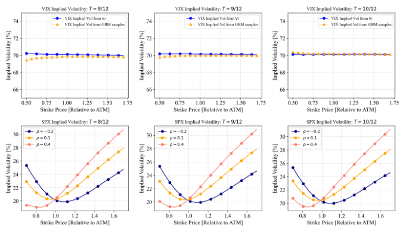
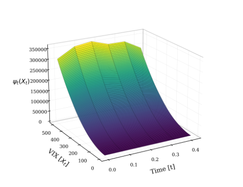
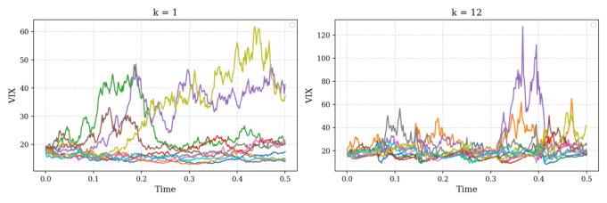
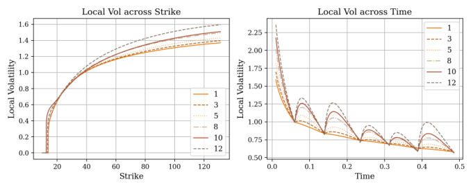
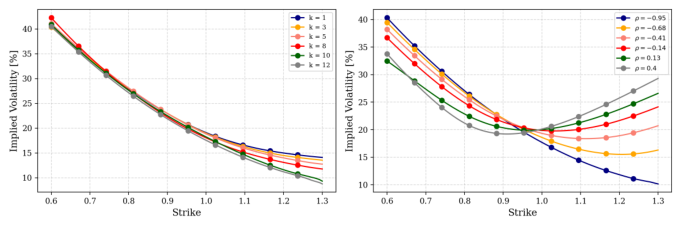
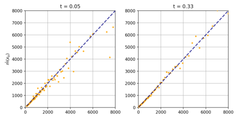
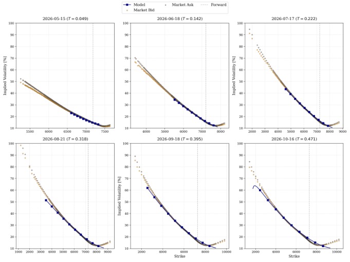
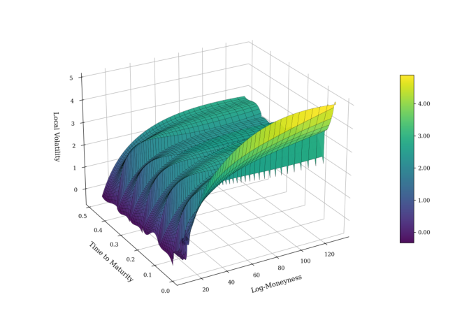

# paper.pdf

Local extraction; verify mathematical notation and material table values against the original.

[Original PDF](original.pdf) · [Extraction report](report.md)

## PDF page 1 (label 1)

[Page image](pages/page-0001.png) · [Original PDF](original.pdf#page=1)

## The VIX-Derived Volatility Model: A VIX-first Joint SPX-VIX Framework

NICOLA F. ZAUGG [a,c,] _[∗]_, LECH A. GRZELAK [a,b]

_a_ _Mathematical Institute, Utrecht University, Utrecht, the Netherlands_
_b_ _Financial Engineering, Rabobank, Utrecht, the Netherlands_
_c_ _LGT Bank, Zurich, Switzerland_

**Abstract**

We propose the _VIX-derived volatility (VDV)_ model, a VIX-first framework for joint SPXVIX modeling. In the model, we define explicit dynamics for the VIX process to price VIX
futures and options, yielding a VIX-side calibration that is independent of the SPX dynamics.
Using the rolling-window definition of the VIX, we then derive a coupling function to obtain
the SPX volatility process as a latent process consistent with the calibrated VIX dynamics.
This produces a stochastic-volatility representation for SPX that can be further calibrated
to SPX options without altering the VIX dynamics. Relative to existing joint-calibration
approaches based on global optimization or highly flexible black-box dynamics, the method
offers an interpretable and tractable decomposition of the joint problem by separating the
calibration of the VIX from the calibration of the SPX. In a numerical experiment, we show
that a VDV model with local volatility and mean-reverting dynamics for the VIX achieves a
close model fit to the VIX futures market, VIX option market, and the SPX option market at
the same time, providing a consistent joint framework.

_Keywords:_ VIX Local Volatility, Stochastic Volatility, SPX VIX Joint Calibration

**1. Introduction**

The joint modeling of S&P 500 (SPX) and VIX derivatives presents a persistent challenge
in quantitative finance. The _CBOE Volatility Index_ (VIX) is a financial index measuring the
expected future volatility of the SPX, derived from the SPX option market . The definition
of the VIX links the spot price of the VIX to index options on the SPX. These SPX options,
on the other hand, are sensitive to the VIX volatility, i.e., the volatility of the volatility of
the SPX. Since both the VIX and the SPX have actively traded index options, joint modeling
requires a model that fits both option markets, as well as the VIX futures market. The
structural interdependence complicates the construction of models that consistently reproduce
both markets, as each market component requires a separate calibration. This is especially
challenging for short maturities where the SPX skew is steep, and VIX smiles are relatively
flat [19].
Traditional approaches to the joint problem rely on parametric stochastic volatility models, such as Heston-type or rough volatility frameworks, which attempt to capture both SPX
and VIX dynamics within a unified specification [19, 3]. These models often face calibration
tensions and require careful tuning to reconcile the two surfaces. More recent nonparametric
methods, including martingale optimal transport and Schrödinger bridge constructions, offer greater flexibility but typically involve global optimization across marginal distributions

[15, 17]. Neural SDEs have also been proposed to jointly calibrate SPX and VIX surfaces with
high flexibility [18].

~~_∗_~~ Corresponding author.
_Email addresses:_ `N.F.Zaugg@uu.nl` (NICOLA F. ZAUGG ), `L.A.Grzelak@uu.nl` (LECH A. GRZELAK)
The views expressed in this paper are the author’s personal views and do not necessarily reflect the views
or policies of their current or past employers. The authors have no competing interests.

1

---

## PDF page 2 (label 2)

[Page image](pages/page-0002.png) · [Original PDF](original.pdf#page=2)

In this work, we propose a modular framework that reverses the conventional modeling order. We begin by defining the VIX index dynamics as a separate model that can be calibrated
to VIX option prices and VIX futures. This yields a one-factor diffusion with transition density and drift-volatility coefficients inferred from market data. Leveraging the rolling-window
definition of VIX [2], we derive a backward equation for the conditional expectation of integrated variance. The backward equation reduces the specification of a coupling map between
the VIX index and a volatility process to a single interval, called the terminal interval. We
show how to derive this coupling map for _polynomial processes_, and how to approximate it
for general, non-polynomial processes. The framework generalizes stochastic volatility models
with a single driver for volatility and VIX. It yields a transparent and tractable framework for
joint SPX-VIX modeling, grounded in observable market data and realistic VIX and volatility
processes.

_1.1. Definition of a Joint SPX-VIX framework_

We consider the price process ( _S_ _t_ ) _t≥t_ 0 of the discounted and dividend-adjusted SPX on a
risk-neutral probability space (Ω _, F,_ Q) with filtration F = _{F_ _t_ _, t ≥_ _t_ 0 _}_ . Its dynamics are taken
to be
d _S_ _t_ = _σ_ _t_ d _W_ _t_ _,_ _v_ _t_ := _σ_ _t_ [2] _[,]_

_S_ _t_

where _W_ is a Brownian motion and _v_ _t_ is the _instantaneous variance_ of the process. By Itô’s
formula, we derive the log-transformation of the process as

_σ_ _u_ d _W_ _u_ _._
_t_ 0

log _[S]_ _[T]_

2

_S_ _t_ _[T]_ 0 = _−_ [1] 2

� _T_

_T_ � _T_

_v_ _u_ d _u_ +
_t_ 0 _t_ 0

Taking conditional expectation eliminates the martingale term:

�

_._ (1.1)

�� _T_

�
E log _S_ _[S]_ _t_ _[T]_ 0 _| F_ _t_ 0

�
E log _[S]_ _[T]_

�
= _−_ [1]

[1] 2 [E]

_v_ _u_ d _u | F_ _t_ 0
_t_ 0

The VIX index emerges naturally as the square root of the average expected variance over a
30-day window. Throughout the paper, we denote the constant Θ = 30 _/_ 365 as the 30-day time
horizon in years. The forward average variance over an interval [ _t, t_ + Θ] for _t ≥_ _t_ 0 is defined
as

_v_ ¯ _t_ := [1]

Θ

� _t_ +Θ

_v_ _u_ d _u._
_t_

Applying (1.1) shows that the conditional expectation of the average variance can be written
as the log-transformed SPX process:

E[¯ _v_ _t_ _| F_ _t_ ] = _−_ Θ [2] [E] _[t]_

E[¯ _v_ _t_ _| F_ _t_ ] = _−_ [2]

�
log _[S]_ _[t]_ [+Θ] _| F_ _t_

_S_ _t_

�
_._

We define the VIX process [1] ( _X_ _t_ ) _t≥t_ 0 as the _F_ _t_ -adapted process of the square root of this forward
expected variance, annualized and scaled:

~~�~~
Θ [2] [E] log _[S]_ _[t]_ [+Θ]

�

_X_ _t_ := �

E[¯ _v_ _t_ _| F_ _t_ ] =

_−_ [2]

_| F_ _t_
_S_ _t_

~~�~~
_._ (1.2)

The VIX index is actively being traded through a futures market. Furthermore, there is a
highly liquid market for European options on the VIX index. A European call or put with
strike _K ∈_ R + and maturity _T ≥_ _t_ 0 has payoff

( _X_ _T_ _−_ _K_ ) [+] or ( _K −_ _X_ _T_ ) [+] _,_

~~1~~ Note that in practice, the VIX is scaled by a factor of 100. Without loss of generality, we will assume an
unscaled VIX process.

2

---

## PDF page 3 (label 3)

[Page image](pages/page-0003.png) · [Original PDF](original.pdf#page=3)

and must have an arbitrage-free price at time _t ≤_ _T_ under the risk-neutral measure Q. A
reasonable joint model of ( _S_ _t_ _, X_ _t_ ) therefore must be calibrated to both the SPX options market, as well as the VIX options and futures market, where the VIX dynamics are given by
Equation (1.2). The pricing formulas reveal the distributional dependencies of ( _S_ _t_ ) _t≥t_ 0 when
valuing SPX and VIX options. For European options on the SPX maturing at a time _T > t_ 0,
the option price only depends on the distribution of the variable

_Z_ _T_ := log _S_ _T_ _,_

since plain calls and puts depend only on _S_ _T_ . For VIX options, by rewriting the settlement
index as
_X_ _T_ [2] [=] _[ −]_ [2] � _Y_ _T_ _−_ _Z_ _T_ � _,_ _Y_ _T_ = E� log _S_ _T_ +Θ _| F_ _T_ � _,_

Θ

it is clear that valuation of an _X_ _T_ -claim depends on the joint distributional properties of the
_F_ _T_ -random variable ( _Z_ _T_ _, Y_ _T_ ).
We summarize these insights with the definition of a joint framework:

**Definition 1.1** (Joint SPX VIX Framework) **.** _Let_ ( _S_ _t_ ) _t≥t_ 0 _be a model process for the SPX and_
_let_ ( _X_ _t_ ) _t≥t_ 0 _be given by (1.2). We call_ ( _S_ _t_ _, X_ _t_ ) _t≥t_ 0 _a_ joint framework _for the SPX and VIX_
_if the model prices of the following T_ _-claims match the observed market prices for all expiries_
_T ≥_ _t_ 0 _:_

_i) SPX European options:_ ( _S_ _T_ _−_ _K_ ) [+] _or_ ( _K −_ _S_ _T_ ) [+]

_ii) VIX European options:_ ( _X_ _T_ _−_ _K_ ) [+] _or_ ( _K −_ _X_ _T_ ) [+]

_iii) VIX Futures contracts:_ ( _X_ _T_ _−_ _K_ )

A consistent joint model of the SPX and VIX derivatives markets is not solely a theoretically
motivated challenge, but is of practical importance for hedging and risk management, since
market participants routinely use SPX options to hedge VIX exposure and vice versa [7]. For
instance, portfolio managers use VIX options for tail-risk hedging of SPX portfolios.

_1.2. Existing Research_

The joint SPX-VIX calibration problem has sparked extensive research in mathematical
finance over the last two decades. The most common approaches attempt to apply classical
stochastic volatility models to the SPX-VIX problem. These methods specify dynamics for the
instantaneous variance process ( _v_ _t_ ) _t≥t_ 0 as a Markovian semimartingale, which then flows into
the definitions of ( _S_ _t_ ) _t≥_ 0 and ( _X_ _t_ ) _t≥_ 0 . If ( _v_ _t_ ) _t≥t_ 0 is flexible enough, the model can then be
calibrated to SPX options, VIX options, and VIX futures. Various articles examined classical
stochastic volatility models for ( _v_ _t_ ) _t≥t_ 0, or adaptations thereof. Gatheral considered a CEV
model [13] for a joint model, Baldeaux and Badran [5] utilized a 3/2 model with jumps,
and Fouque and Saporito [12] a generalization of the Heston model. Grzelak [14] considered
randomizations of affine diffusion processes, and Ballotta et al. considered time-changed Lévy
processes [6]. These models were only partially successful at fitting to the market. A possible
explanation for this phenomenon was shown by Guyon et al [16], where they explored a general
phenomenon for stochastic volatility models and posed a necessary condition for such models
to fit the market, called the _inversion of complex order_ .
Since classical stochastic volatility models struggle with this condition and are therefore
not general enough to fit both markets, researchers extended the models in various directions.
Abi-Jaber et al. [3] introduced _Gaussian Polynomial_ volatility models, and Cuchiero et al. [10]
utilize signature models to define the volatility process. Alternative approaches to stochastic
volatility models for the joint problem exist. In the _martingale optimal transport_ approach,
the problem is formulated as an optimal transport problem in discrete time [15, 17]. Although
the novel approaches produce promising numerical results, a common issue with these models
is complexity. The instantaneous variances are modeled with increasing complexity by adding
additional stochastic drivers or functionals. This increases both model and numerical complexity, leading to long calibration times, unstable parameters, and results that are difficult to
interpret in practice.

3

Θ

� _Y_ _T_ _−_ _Z_ _T_ � _,_ _Y_ _T_ = E� log _S_ _T_ +Θ _| F_ _T_ � _,_

---

## PDF page 4 (label 4)

[Page image](pages/page-0004.png) · [Original PDF](original.pdf#page=4)

Lastly, a similar method to our proposed framework was introduced by Papanicolaou [22].
The model derives a stochastic volatility process from a factor model, that is simultaneously
used to calibrate to the VIX futures market. Similarly, Papanicolaou shows how to derive
a coupling function between the processes. The approach, however, focuses on VIX futures
market models and not VIX options, and is restricted to time-homogeneous factors.

_1.3. Proposed Framework_

We propose an intuitive approach to joint SPX-VIX modeling, called the VIX-derived
volatility (VDV) framework. The model is a _stochastic volatility model_ : the instantaneous
variance of the SPX, ( _v_ _t_ ) _t≥t_ 0, is an adapted stochastic process. Unlike classical stochastic
volatility models, however, ( _v_ _t_ ) _t≥t_ 0 is not modeled explicitly but instead emerges as a latent
process derived from the dynamics of the VIX. The VIX process itself is modeled explicitly,
allowing seamless calibration to both the VIX futures and options markets. We then derive
the corresponding instantaneous volatility dynamics by defining a smooth coupling map _ψ_ :

[ _t_ 0 _, ∞_ ) _×_ R + _→_ R + such that _v_ _t_ = _ψ_ _t_ ( _X_ _t_ ). This map depends on the specification of ( _X_ _t_ ) _t≥t_ 0
and can be derived explicitly for polynomial processes, a specific process class. In the general,
non-polynomial case, we derive a numerical approximation of the map based on the same
principles.
Utilizing the mean-reverting local volatility framework following the work of Drimus and
Farkas [11], we introduce the Local Volatility VIX model, an implementation of the VDV
model. The explicit dynamics of the VIX process ( _X_ _t_ ) _t≥t_ 0 allow us to fit VIX options and
futures with distinct parameters for each component. We then derive the SPX dynamics that
are calibrated to the SPX option market. The numerical results show that the model generates
realistic mean-reverting dynamics for the VIX, and is flexible enough to reprice the SPX options
market.
The remainder of the paper is organized as follows. Having introduced the VIX and the
joint VIX–SPX calibration problem above, we describe in Section 2 the general framework
of the VDV model for capturing the joint Q-dynamics of the SPX and the VIX. We then
introduce the properties of the coupling function linking the two processes and derive the
backward equation for a consistent VDV framework, given by Equation (2.8). A first example
of a VDV model is provided in Section 2.3, illustrating the framework on a simple diffusion
process. In Section 2.4 we introduce polynomial processes and show how they are used to derive
the coupling function for general processes. An algorithmic description of the full process to
derive the coupling function is included in Appendix C. In Section 3 we introduce the LV-VIX
model, a local-volatility-based VDV model that produces realistic volatility dynamics, and in
Section 4 we apply this implementation to market data from April 27th, 2026. We conclude the
paper in Section 5, followed by Appendix A, which contains accompanying theoretical results.

**2. A VIX-first Stochastic Volatility Model**

_2.1. General Model Dynamics_

The _VDV_ model is a joint SPX/VIX framework emerging from an explicit stochastic model
for the VIX process. Let (Ω _, F_ _,_ Q) be a probability space with filtration _F_ _t_ _, t ≥_ _t_ 0 . We define
the discounted SPX process ( _S_ _t_ ) _t≥t_ 0 and the VIX process ( _X_ _t_ ) _t≥t_ 0 through a system of two
differential equations linked through a function _ψ_ _t_ ( _x_ ). The dynamics of ( _X_ _t_ ) _t≥t_ 0 follow a
general Itô process with drift term _µ_ ( _t, x_ ) and diffusion term _σ_ ( _t, x_ ). We consider the following
dynamics on [ _t_ 0 _, ∞_ ):

d _SS_ _tt_ = _[√]_ ~~_v_~~ _t_ d _W_ _t_ [(] _[S]_ [)] _,_ (2.1)

_v_ _t_ = _ψ_ _t_ ( _X_ _t_ ) _,_ (2.2)

d _X_ _t_ = _µ_ ( _t, X_ _t_ ) d _t_ + _σ_ ( _t, X_ _t_ )d _W_ _t_ [(] _[X]_ [)] _._ (2.3)

The expressions _W_ _t_ [(] _[X]_ [)] _, W_ _t_ [(] _[S]_ [)] are Brownian motions with a correlation coefficient given by
d _W_ _t_ [(] _[X]_ [)] d _W_ _t_ [(] _[S]_ [)] = _ρ_ d _t_ . Since the VIX is a strictly positive quantity, we require _µ_ ( _t, x_ ) _, σ_ ( _t, x_ ) to

4

---

## PDF page 5 (label 5)

[Page image](pages/page-0005.png) · [Original PDF](original.pdf#page=5)

be chosen such that ( _X_ _t_ ) _t≥t_ 0 is almost surely a positive process. Furthermore, for Lemma 2.2
we require that the functions satisfy the usual linear growth conditions. There exists a constant
_K >_ R, such that
_|µ_ ( _t, x_ ) _|_ + _|σ_ ( _t, x_ ) _| ≤_ _K_ (1 + _x_ ) _,_ _x ∈_ R + _._ (2.4)

The function _ψ_ : [ _t_ 0 _, ∞_ ) _×_ R + _→_ R + is called the _coupling function_, as it couples the VIX at time
_t_ to the _instantaneous variance_ ( _v_ _t_ ) _t≥t_ 0 . We study this coupling function in detail in Section 2.2.
For the system to be well-defined, we require it to be positive and measurable, such that ( _v_ _t_ ) _t≥t_ 0
is an adapted, almost surely positive stochastic process. Although the instantaneous variance
process ( _v_ _t_ ) _t≥t_ 0 is not explicitly modeled by a stochastic differential equation, one can derive
the SDE for ( _v_ _t_ ) _t≥t_ 0 through Itô’s lemma under additional assumptions of differentiability of
_ψ_ .

_2.2. From VIX to Instantaneous Variance - Coupling Function_
The essence of the joint model defined in eqs. (2.1) to (2.3) is the coupling function
_ψ_ : [ _t_ 0 _, ∞_ ) _×_ R + _→_ R +, that links the two stochastic processes through the process of the
instantaneous variance ( _v_ _t_ ) _t≥t_ 0 . Although not strictly required, we will assume _ψ_ _t_ ( _x_ ) to be
smooth in the space components (i.e., _x �→_ _ψ_ _t_ ( _x_ ) _∈_ _C_ _[∞]_ _, ∀t ≥_ _t_ 0 ), and at least continuous in
the time direction. The continuity of _ψ_ _t_ ensures that ( _v_ _t_ ) _t≥t_ 0 is adapted and almost surely continuous. A direct consequence of such a coupling model is that _v_ _t_ is a _X_ _t_ -measurable random
variable for all _t ≥_ _t_ 0, since _ψ_ is a deterministic function. Therefore, we have the interpretation
of _ψ_ _t_ as the conditional expectation of _v_ _t_ given the current level _X_ _t_ .

E [ _v_ _t_ _| X_ _t_ ] = _v_ _t_ = _ψ_ _t_ ( _X_ _t_ ) _._ (2.5)

Here, E [ _v_ _t_ _| X_ _t_ ] represents the conditional expectation of _v_ _t_ given the _σ_ -algebra _σ_ ( _X_ _t_ ) generated
by _X_ _t_ .
Under the positivity assumptions, the general model of eqs. (2.1) to (2.3) is well-defined.
However, since the VIX-process is also derived from the SPX as described in Section 1.1, the
choice of _ψ_ _t_ is not free, as the definition of the VIX through Equation (1.2) must be fulfilled for
all times _t ≥_ _t_ 0 . The additional condition on the interaction of ( _X_ _t_ ) _t≥t_ 0 and ( _S_ _t_ ) _t≥t_ 0 further
restricts the choice of _ψ_ _t_ . We introduce the concept of _consistency_ of the coupling function _ψ_ .

**Definition 2.1** (Consistency) **.** _We call the model eqs._ (2.1) _to_ (2.3) _consistent if for all t ≥_ _t_ 0 _,_
_we have_

_,_ _a.s._ (2.6)

_X_ _t_ [2] [=] [1]

�� _t_ +Θ

Θ [E]

_v_ _u_ d _u_
_t_

_F_ _t_
�����

�

_In this case, we call ψ a consistent coupling function. Equation_ (2.6) _is called the_ consistency
equation

The definition of consistency poses the questions of existence and uniqueness of a consistent
_ψ_ given a process ( _X_ _t_ ) _t≥t_ 0 . To answer these questions, we first assume that a consistent _ψ_
exists. We will now show that, under the assumption of consistency, the specification of _ψ_ can
be restricted to a shorter time interval [ _T, T_ + Θ] of length Θ, as _ψ_ _t_ outside of the interval can
be uniquely traced back to the definition of _ψ_ _t_ inside the interval. This temporal dependency
evolves as a necessary condition of Equation (2.6) through the Feynman-Kac theorem. We first
apply the Feynman-Kac theorem to the right-hand side of Equation (2.6) to obtain a partial
differential equation for the conditional expectation.

**Lemma 2.2** (Rolling-window backward equation) **.** _Suppose the dynamics of a stochastic pro-_
_cess_ ( _X_ _t_ ) _t≥t_ 0 _solve the differential equation_

d _X_ _s_ = _µ_ ( _s, X_ _s_ ) d _s_ + _σ_ ( _s, X_ _s_ ) d _W_ _s_ [(] _[X]_ [)] _,_

_where µ_ ( _t, x_ ) _, σ_ ( _t, x_ ) _are continuous and satisfy the linear growth condition, and let_

_,_ _ϕ_ _t_ ( _x_ ) := E [ _ψ_ _t_ +Θ ( _X_ _t_ +Θ ) _| X_ _t_ = _x_ ] _._

5

�

_X_ _t_ = _x_
�����

_I_ _t_ ( _x_ ) := E

�� _t_ +Θ

_ψ_ _u_ ( _X_ _u_ ) d _u_
_t_

�� _t_ +Θ

---

## PDF page 6 (label 6)

[Page image](pages/page-0006.png) · [Original PDF](original.pdf#page=6)

_Suppose that for all t the function ψ_ _t_ ( _x_ ) _is smooth and ψ_ _t_ ( _X_ _t_ ) _is integrable. Then, for any_
_t ≥_ _t_ 0 _, the expression I_ _t_ ( _x_ ) _satisfies:_

_∂_ _t_ _I_ _t_ ( _x_ ) + _µ_ ( _t, x_ ) _∂_ _x_ _I_ _t_ ( _x_ ) + [1] 2 _[σ]_ [2] [(] _[t, x]_ [)] _[∂]_ _[xx]_ _[I]_ _[t]_ [(] _[x]_ [) +] _[ ψ]_ _[t]_ [(] _[x]_ [)] _[ −]_ _[ϕ]_ _[t]_ [(] _[x]_ [) = 0] _[.]_ (2.7)

_Proof._ Fix _s ≥_ _t_ 0 and consider the auxiliary function:

�� _s_ �
_W_ ( _s, t, x_ ) := E _ψ_ _u_ ( _X_ _u_ ) d _u_ _X_ _t_ = _x_ _._

_t_ ����

Note that _W_ ( _t, t, x_ ) = 0 and our target function is _I_ _t_ ( _x_ ) = _W_ ( _t_ + Θ _, t, x_ ). Since _ϕ_ is bounded
and measurable, the function ( _t, x_ ) _�→_ _W_ ( _s, t, x_ ) is of the class _C_ [1] _[,]_ [2] . By the Feynman-Kac
backward relation for a running cost with a terminal condition of zero at _t_ = _s_, we obtain

( _∂_ _t_ + _L_ _X_ ) _W_ ( _s, t, x_ ) + _ψ_ _t_ ( _x_ ) = 0 _,_ _W_ ( _s, s, x_ ) = 0 _,_

where _L_ _X_ _f_ ( _t, x_ ) := _µ_ ( _t, x_ ) _∂_ _x_ _f_ ( _t, x_ ) + [1] 2 _[σ]_ [2] [(] _[t, x]_ [)] _[∂]_ _[xx]_ _[f]_ [(] _[t, x]_ [)][.]

By the integrability of _ψ_, we can differentiate the function _W_ ( _s, t, x_ ) with respect to its
first argument, and we obtain, using the Leibniz rule,

_∂_ _s_ _W_ ( _s, t, x_ ) _|_ _s_ = _s_ = E [ _ψ_ _s_ ( _X_ _s_ ) _| X_ _t_ = _x_ ] _._

Now, we apply the operator ( _∂_ _t_ + _L_ _X_ ) to the function _I_ _t_ ( _x_ ) = _W_ ( _t_ + Θ _, t, x_ ), using the chain
rule for the moving horizon _s_ ( _t_ ) = _t_ + Θ:

�
( _∂_ _t_ + _L_ _X_ ) _I_ _t_ ( _x_ ) = [( _∂_ _t_ + _L_ _X_ ) _W_ ( _s, t, x_ )] _s_ = _t_ +Θ + _∂_ _s_ _W_ ( _s, t, x_ ) [d] _[s]_

d _t_

�

_._
_s_ = _t_ +Θ

Since [d] d _[s]_ _t_ [= 1][, substituting our previous identities yields:]

( _∂_ _t_ + _L_ _X_ ) _I_ _t_ ( _x_ ) = _−ψ_ _t_ ( _x_ ) + E [ _ψ_ _t_ +Θ ( _X_ _t_ +Θ ) _| X_ _t_ = _x_ ] _._

Recalling the definition _ϕ_ _t_ ( _x_ ) := E[ _ψ_ _t_ +Θ ( _X_ _t_ +Θ ) _|X_ _t_ = _x_ ], we arrive at:

_∂_ _t_ _I_ _t_ ( _x_ ) + _µ_ ( _t, x_ ) _∂_ _x_ _I_ _t_ ( _x_ ) + [1] 2 _[σ]_ [2] [(] _[t, x]_ [)] _[∂]_ _[xx]_ _[I]_ _[t]_ [(] _[x]_ [) +] _[ ψ]_ _[t]_ [(] _[x]_ [)] _[ −]_ _[ϕ]_ _[t]_ [(] _[x]_ [) = 0] _[.]_

This proves the claim. 

The differential equation Equation (2.7) describes the time dynamics of _I_ _t_ ( _x_ ). Since we
defined _v_ _t_ in our model to be _σ_ ( _X_ _t_ )-measurable, we can derive that under a consistent model,
_I_ _t_ ( _x_ ) describes the (scaled) squared VIX process. From the definition of a consistent model,
we apply the tower property and find

Θ _X_ _t_ [2] [= Θ][E] � _X_ _t_ [2] �� _X_ _t_ �

_X_ _t_
������

�

= E

�� _t_ +Θ

E

_v_ _u_ d _u_
_t_

_F_ _t_
�����

�

�� _t_ +Θ

= E

_v_ _u_ d _u_
_t_

_X_ _t_
�����

�

= _I_ _t_ ( _X_ _t_ ) _._

In a consistent model, _I_ _t_ ( _X_ _t_ ) is explicitly given by Θ _X_ _t_ [2] [, and we can apply the newly derived]
backward equation to this formula. This yields an explicit temporal dependency of _ψ_ _t_ .

**Corollary 2.1** (Consistency relation) **.** _In a consistent model we have I_ _t_ ( _x_ ) = Θ _x_ [2] _and there-_
_fore we find_
_ψ_ _t_ ( _x_ ) = _ϕ_ _t_ ( _x_ ) _−_ Θ�2 _x µ_ ( _t, x_ ) + _σ_ [2] ( _t, x_ )� _._ (2.8)

_Proof._ With _I_ _t_ ( _x_ ) = Θ _x_ [2] we have _∂_ _t_ _I_ = 0, _∂_ _x_ _I_ = 2Θ _x_, and _∂_ _xx_ _I_ = 2Θ. Plugging into
Lemma 2.2 yields
0 = Θ�2 _x µ_ ( _t, x_ ) + _σ_ [2] ( _t, x_ )� + _ψ_ _t_ ( _x_ ) _−_ _ϕ_ _t_ ( _x_ ) _,_

which rearranges to the stated identity. 

6

---

## PDF page 7 (label 7)

[Page image](pages/page-0007.png) · [Original PDF](original.pdf#page=7)

The backward equation is not a definition of _v_ _t_ = _ψ_ _t_ ( _X_ _t_ ). Rather, it maps the definition
of _v_ _t_ +Θ to the _v_ _t_ for the fixed time Θ = 36530 [. In particular, given the process] _[ X]_ _[t]_ [, if we define]
_v_ _t_ on a domain [ _T, T_ + Θ], we can derive _v_ _t_ for any _t ≤_ _T_ . To see this, let the function _ψ_ _t_ ( _x_ )
be given on [ _T, T_ + Θ]. We can derive _ψ_ _t_ ( _x_ ) for any _t ∈_ [ _T −_ Θ _, T_ ) through Equation (2.8), by

_ψ_ _t_ ( _X_ _t_ ) = E[ _ψ_ _t_ +Θ ( _X_ _t_ +Θ ) _| X_ _t_ ] _−_ Θ�2 _X_ _t_ _µ_ ( _t, X_ _t_ ) + _σ_ [2] ( _t, X_ _t_ )� _._

Since we have now derived _v_ _t_ = _ψ_ _t_ ( _X_ _t_ ) on [ _T −_ Θ _, T_ +Θ], we can repeat the argument and derive
_ψ_ _t_ for all _t ≥_ _t_ 0 . This shows that a consistent model is fully determined by its restriction to
a single interval of length Θ. For this reason, we introduce the concept of a _terminal interval_

[ _T_ _F_ _, T_ _F_ + Θ], where _T_ _F_ _> t_ 0, over which we will choose the definition of _ψ_ as part of the
modeling. We denote the function _ψ_ _t_ on the terminal interval as a _terminal curve_

_**ψ**_ _T_ _F_ := _{ψ_ _t_ _∈_ _C_ _[∞]_ : _t ∈_ [ _T_ _F_ _, T_ _F_ + Θ] _}._ (2.9)

Although processes _v_ _t_ and _X_ _t_ exist beyond the terminal interval, we will assume that
beyond _T_ _F_ + Θ, the exact value of _ψ_ _t_ and _v_ _t_ are left unspecified. By introducing the terminal
curve, we can reduce the construction of _ψ_ _t_ to a single interval [ _T_ _F_ _, T_ _F_ + Θ], after which the
process on [ _t_ 0 _, T_ _F_ +Θ) is given by _X_ _t_ and the backward equation in Equation (2.8). To ensure
consistency in the model and well-definedness, we constrain a terminal curve with additional
conditions of continuity and consistency:

**Definition 2.3** (Consistent Terminal Curve) **.** _A_ consistent terminal curve _for a terminal time_
_T_ _F_ _≥_ _t_ 0 _is the family of functions_ _**ψ**_ _T_ _F_ = _{ψ_ _t_ _∈_ _C_ _[∞]_ : _t ∈_ [ _T_ _F_ _, T_ _F_ + Θ] _}, such that_

_i) ψ_ _T_ _F_ ( _x_ ) _, ψ_ _T_ _F_ +Θ ( _x_ ) _fulfill the backward relation_

_ii) The map t �→_ _ψ_ _t_ _is continuous on_ [ _T_ _F_ _, T_ _F_ + Θ]

_iii) The consistency equation is fulfilled at t_ = _T_ _F_ _:_

_,_ _a.s._

�� _T_ _F_ +Θ

Θ _X_ _T_ [2] _F_ [=][ E]

_ψ_ _u_ ( _X_ _u_ ) d _u_
_T_ _F_

_X_ _T_ _F_
�����

�

These conditions ensure that the previous definition of consistency is fulfilled across the
entire interval [ _t_ 0 _, T_ _F_ +Θ]. While Condition ii) is a basic assumption of _ψ_ across time, Condition
i) ensures that the previously established backward relation is also true at the terminal time.
As we will show below, Condition iii) suffices to ensure that the model remains consistent
across the entire time interval.
The three requirements for a consistent terminal curve are relatively weak and allow for a
large range of terminal curves. Defining a function _ψ_ _T_ _F_ +Θ ( _._ ) specifies _ψ_ _T_ _F_ ( _._ ) through Condition
i). Since these two functions are homotopic, any continuous deformation of these functions will
fulfill Conditions i) and ii). It then remains to deform them in a way such that property iii) is
fulfilled, which is non-unique.
It remains to show that a consistent terminal curve _remains_ consistent as we move backward
in time

**Lemma 2.4** (Backward Consistency) **.** _Let_ ( _X_ _t_ ) _t≥t_ 0 _be a given VIX process in a VDV frame-_
_work, and consider a terminal curve_ _**ψ**_ _T_ _F_ = _{ψ_ _t_ _∈_ _C_ _[∞]_ : _t ∈_ [ _T_ _F_ _, T_ _F_ + Θ] _} which is consistent._
_Then, for all t ≤_ _T_ _F_ _, we have_

�

_._

_X_ _t_ [2] [=] [1]

Θ [E]

�� _t_ +Θ

_ψ_ _u_ ( _X_ _u_ )d _u_ _X_ _t_
_t_ ����

_Proof._ Consider the PDE (2.7) on the interval [ _t_ 0 _, T_ _F_ ]. We claim that if _ψ_ _t_ follows the backward
equation, then _I_ _t_ ( _x_ ) = Θ _x_ [2] is a solution to this PDE. Since _∂_ _t_ _I_ = 0 _, ∂_ _x_ _I_ = 2 _x_ Θ and _∂_ _x_ _xI_ = 2Θ,
we have
Θ �2 _xµ_ ( _t, x_ ) + _σ_ [2] ( _t, x_ )� + _ψ_ _t_ ( _x_ ) _−_ _ϕ_ _t_ ( _x_ ) = 0 _,_

This means that _I_ _t_ ( _x_ ) = Θ _x_ [2] is a solution to this PDE. Given the regularity conditions of
the PDE, and since Θ _x_ [2] fulfills the boundary condition by the terminal curve assumption, we

7

---

## PDF page 8 (label 8)

[Page image](pages/page-0008.png) · [Original PDF](original.pdf#page=8)

conclude by the Feynman-Kac uniqueness theorem under polynomial growth that _I_ _t_ ( _x_ ) = Θ _x_ [2]

is the unique solution fulfilling the PDE. We can therefore conclude that

_̸_

_,_ _t ∈_ [ _t_ 0 _, T_ _F_ ] _,_

_̸_

Θ _x_ [2] = E

_̸_

�� _t_ +Θ

_̸_

_ψ_ _u_ ( _X_ _u_ )d _u_ _X_ _t_ = _x_
_t_ ����

_̸_

�

_̸_

from which we deduce the equation in the claim. 

While the lemma proves that a consistent terminal curve leads to a _consistent_ model (as
defined by Definition 2.1), it is unclear if the model is well-defined. The reason is that _ψ_ _t_ is not
guaranteed to be a positive function on [ _t_ 0 _, T_ _F_ ), even if the terminal curve is chosen entirely
from positive functions. To our knowledge, there is no general condition to ensure positivity.
For specific classes of ( _X_ _t_ ) _t≥t_ 0 and _ψ_, it is possible to show the existence of a consistent,
positive _ψ_ across the entire interval (see Section 2.3 and Section 2.4).

_2.3. VIX as Geometric Brownian Motion_

We now illustrate the theoretical concepts with an example where the VIX process ( _X_ _t_ ) _t≥t_ 0
follows a driftless geometric Brownian motion (GBM). We consider a VDV model on _t ∈_

[ _t_ 0 _, T_ _F_ + Θ] with the following dynamics:

d _SS_ _tt_ = _[√]_ ~~_v_~~ _t_ ~~d~~ _W_ _t_ [(] _[S]_ [)] _,_

_v_ _t_ = _ψ_ _t_ ( _X_ _t_ ) _,_

d _X_ _t_ = _σX_ _t_ d _W_ _t_ [(] _[X]_ [)] _,_

where the parameter _σ >_ 0 defines the VIX volatility and _X_ _t_ 0 _, S_ _t_ 0 _>_ 0 are the given start
values. We aim to derive a consistent coupling function _ψ_ to complete the joint model. The
first step is therefore to define a consistent terminal curve _**ψ**_ _T_ _F_ for a terminal time _T_ _F_ . Since
the VIX process can be interpreted as the _expectation of the average future variance v_ _t_, we
use a quadratic ansatz _ψ_ _t_ ( _x_ ) = _x_ [2] on _t ∈_ [ _T_ _F_ _, T_ _F_ + Θ]. We derive the right-hand side of the
consistency equation (2.6):

_̸_

= [1]

Θ

_̸_

�� _t_ +Θ

_̸_

� �
e _[σ]_ [2] [Θ] _−_ 1

_X_ _t_ [2] _[.]_ (2.10)
_σ_ [2] Θ

_̸_

1
Θ [E]

_̸_

_ψ_ _u_ ( _X_ _u_ ) d _u_
_t_

_̸_

� Θ

e _[σ]_ [2] _[u]_ d _u X_ _t_ [2] [=]
0

_̸_

_F_ _t_
�����

_̸_

�

_̸_

This follows from the property of the geometric Brownian motion, where the conditional second
moment is given analytically by

E[ _X_ _t_ [2] +∆ _[|][X]_ _[t]_ [] =] _[ X]_ _t_ [2] [e] _[σ]_ [2] [∆] _[,]_ (2.11)

for any ∆ _≥_ 0. From Equation (2.10) we see that the terminal curve is not consistent, as
�e _[σ]_ [2Θ] _−_ 1�

_σ_ [2] Θ _̸_ = 1. To adjust for the scaling term, we therefore apply a scalar _c >_ 0 to the
definition of _ψ_ and consider the case where the terminal curve is given by

_σ_ [2] Θ
_ψ_ _t_ ( _x_ ) := _cx_ [2] _,_ _c_ = ~~�~~ e _[σ]_ [2] [Θ] _−_ 1 ~~�~~ _,_

for _t ∈_ [ _T_ _F_ _, T_ _F_ + Θ]. With this choice of _c_ we find from Equation (2.10) that

_̸_

�� _T_ _F_ +Θ

_̸_

= _[c]_

Θ

_̸_

_X_ _T_ [2] _F_ [=] _[ X]_ _T_ [2] _F_ _[,]_
_σ_ [2] Θ

_̸_

1
Θ [E]

_̸_

_ψ_ _u_ ( _X_ _u_ ) d _u_
_T_ _F_

_̸_

� Θ

_̸_

Θ _c_ �e _[σ]_ [2] [Θ] _−_ 1�

e _[σ]_ [2] _[u]_ d _u X_ _T_ [2] _F_ [=]
0 _σ_ [2] Θ

_̸_

_F_ _T_ _F_
�����

_̸_

�

_̸_

leading to consistency at _T_ _F_ . This means that the terminal curve _**ψ**_ _T_ _F_ fulfills Conditions ii),
iii) of a consistent terminal curve. We need to confirm that the endpoints _ψ_ _T_ _F_ _, ψ_ _T_ _F_ +Θ fulfill the

8

---

## PDF page 9 (label 9)

[Page image](pages/page-0009.png) · [Original PDF](original.pdf#page=9)

VIX backward equation. Applying the VIX backward equation in Equation (2.8) to _ψ_ _T_ _F_ +Θ,
using the observation from Equation (2.11), we find

_σ_ [2] Θ
_x_ [2] = _x_ [2] _._
~~�~~ e _[σ]_ [2] [Θ] _−_ 1 ~~�~~

� �
_ψ_ _T_ _F_ ( _x_ ) = _c_ e _[σ]_ [2] [Θ] _−_ _σ_ [2] Θ _x_ [2] =

� �
_σ_ [2] Θe _[σ]_ [2] [Θ]
_−_ _σ_ [2] Θ
~~�~~ e _[σ]_ [2] [Θ] _−_ 1 ~~�~~

This shows that our terminal curve also fulfills Condition i), and we have found a consistent
terminal curve.
We can then use the backward equation to compute _ψ_ on [ _t_ 0 _, T_ _F_ ). Since the VIX process is
time-homogeneous, and since _ψ_ is constant in time over the terminal curve, we observe that the
backward equation keeps _ψ_ constant until _t_ 0, since the definition of _c_ is time-independent. We
conclude then that the function _ψ_ such that _ψ_ _t_ ( _x_ ) = _c x_ [2] for all _t ∈_ [ _t_ 0 _, T_ _F_ + Θ] is a consistent
coupling function for the GBM-driven VDV model.
With the complete model, we simulate paths of ( _X_ _t_ _, S_ _t_ ) _t≥t_ 0 using a Monte-Carlo procedure,
and price VIX options and SPX options from the simulations. We choose _T_ _F_ = [11] 12 [and] _[ σ]_ [ = 0] _[.]_ [7][,]

resulting in a value of _c ≈_ 0 _._ 98. Figure 1 shows the resulting implied volatility shapes at
various time steps. For the VIX options we plot the implied volatilities directly obtained from
( _X_ _t_ ) _t≥t_ 0 (orange), as well as samples obtained through ( _v_ _t_ ) _t≥t_ 0 using a Least-Square MonteCarlo approach to compute the conditional expectation of the right-hand side of the consistency
equation (2.6) (blue). Since the VIX process is a GBM, the resulting implied volatility slice is
flat at a level of _σ_ . For the SPX options, we obtain flexibility around the skew of the SPX by
varying the correlation parameter _ρ ∈_ [ _−_ 1 _,_ 1], without altering the distribution of _X_ _t_ .

Figure 1: Pricing VIX options and SPX options in the GBM VDV Model: The backward
equation leads to consistent paths.

_2.4. Consistency under Polynomial Processes_

The computations of Section 2.3 showed that a reasonable ansatz for _ψ_ _t_ is to consider a
function with a quadratic component in _x_, due to the interpretation of _X_ _t_ [2] [as the] _[ average]_
_expected volatility_ over a 30-day horizon. In this section, we generalize the result of the GBM
to a more general class of processes for ( _X_ _t_ ) _t≥t_ 0 . We introduce _polynomial processes_ and show
how to derive a consistent terminal curve to complete the VDV model. The theoretical insights
of this section are key to approximating a consistent terminal curve for general VIX dynamics
as in Equation (2.3).
Polynomial processes are a class of stochastic processes introduced by Cuchiero et al. [9] as
a generalization of affine processes. The main property to characterize polynomial processes

9

---

## PDF page 10 (label 10)

[Page image](pages/page-0010.png) · [Original PDF](original.pdf#page=10)

is that the conditional expectation preserves polynomial maps. Initially introduced for timehomogeneous processes, the notion was later generalized to time-inhomogeneous processes [4].
For our purpose, we define polynomial processes on a one-dimensional state space R. Let
_m ∈_ N be a positive integer. Consider the set of functions

_p_ ( _x_ ) =
�����

_m_
�

� _α_ _k_ _x_ _[k]_ _,_ _α_ 0 _, . . ., α_ _m_ _∈_ R

_k_ =0

�

_,_ _m ∈_ N _._ (2.12)

_P_ _m_ :=

�

_p_ : R _→_ R

�

These sets are well-known to be finite-dimensional subspaces of _C_ _[∞]_ (R) for any _m ≥_ 0. Polynomial processes are simply processes that are invariant on _P_ _m_ under conditional expectation.

**Definition 2.5.** _We define an Itô process_ ( _X_ _t_ ) _t≥t_ 0 _to be a_ polynomial process _of degree m ∈_ N
_if for any p ∈P_ _m_ _and any t_ 0 _≤_ _t ≤_ _s, we have_

_p_ _s,t_ ( _x_ ) := E [ _p_ ( _X_ _s_ ) _| X_ _t_ = _x_ ] = _⇒_ _p_ _s,t_ ( _x_ ) _∈P_ _m_ _,_ (2.13)

The reason why polynomial processes are particularly useful for VIX modeling is that
the left-hand side of the consistency equation (2.6) is also a polynomial. Using linearity of
expectation, we can then express the right-hand side as a polynomial as well and determine
the coefficients of a consistent terminal curve. To prove this, we require a technical lemma
about polynomial processes:

**Lemma 2.6.** _Let_ ( _X_ _t_ ) _t≥_ 0 _be a polynomial process._ _For any t_ 0 _≤_ _t < s, the conditional_
_expectation_ E[ _X_ _s_ [2] _[|][ X]_ _[t]_ [=] _[ x]_ []] _[ is a polynomial in][ x][ of degree exactly]_ [ 2] _[ and its leading coefficient]_
_is strictly positive._

_Proof._ See Appendix B.2 

**Theorem 2.7.** _Consider a VDV model with the VIX process_ ( _X_ _t_ ) _t≥t_ 0 _being a polynomial_
_process of degree m ≥_ 2 _, m ∈_ N _, and let_ [ _T_ _F_ _, T_ _F_ + Θ] _be a terminal time. Then, there exists a_
_polynomial p ∈P_ _m_ _of degree m, such that_

_,_ _a.s._ (2.14)

_X_ _T_ [2] _F_ [=] [1]

�� _T_ _F_ +Θ

Θ [E]

_p_ ( _X_ _u_ ) d _u_
_T_ _F_

_F_ _T_ _F_
�����

�

_Proof._ Consider a polynomial _p_ ( _x_ ) := _a_ 0 + _a_ 1 _x_ + _a_ 2 _x_ [2] + _· · ·_ + _a_ _m_ _x_ _[m]_ of degree _m_ . Using the
linearity of the conditional expectation, we find

_F_ _T_ _F_
�����

�� _T_ _F_ +Θ

�� _T_ _F_ +Θ

= E

_T_ _F_

_m_
� _a_ _k_ _X_ _u_ _[k]_ [d] _[u]_

_k_ =0

�

E

_p_ ( _X_ _u_ ) d _u_
_T_ _F_

_F_ _T_ _F_
�����

�

=

=

_m_
� _a_ _k_

_k_ =0

_m_
� _a_ _k_

_k_ =0

� _T_ _F_ +Θ

E� _X_ _u_ _[k]_ �� _F_ _T_ _F_ � d _u_
_T_ _F_

� _T_ _F_ +Θ

� _p_ _T_ _F_ _,u,k_ �( _X_ _T_ _F_ ) d _u,_

_T_ _F_

where _p_ _T_ _F_ _,u,k_ is a polynomial of _k_ degrees, and the interchange of integration and conditional
expectation is justified by Fubini’s theorem. Let us denote _b_ ( _u_ ; _l, k_ ) the _l_ -the coefficient of
the polynomial _p_ _T_ _F_ _,u,k_, where _l ≤_ _k_ . Integrating the coefficients [2] _b_ ( _u_ ; _l, k_ ) from _u_ = _T_ _F_ to
_u_ = _T_ _F_ + Θ, we denote

� _T_ _F_ +Θ
¯ _b_ ( _l, k_ ) =

_b_ ( _u_ ; _l, k_ )d _u._
_T_ _F_

Then, we find
_m_
� _a_ _k_

_k_ =0

Then, we find
_m_
�

� _T_ _F_ +Θ

_T_ _F_

� _p_ _T_ _F_ _,u,k_ �( _X_ _T_ _F_ ) d _u_ =

_k_
� ¯ _b_ ( _l, k_ ) _X_ _T_ _[l]_ _F_ _[.]_

_l_ =0

_k_
�

_m_
� _a_ _k_

_k_ =0

_m_
�

~~2~~ The map _u �→_ _b_ ( _u_ ; _l, k_ ) is continuous in _u_ due to the continuity of _X_ _t_

10

---

## PDF page 11 (label 11)

[Page image](pages/page-0011.png) · [Original PDF](original.pdf#page=11)

For this expression to be equal to Θ _X_ _T_ [2] _F_ [, we obtain a system of] _[ m]_ [ + 1][ equations, where]

_m_
� _a_ _k_ [¯] _b_ ( _l, k_ ) =

_k_ =0

�
Θ _,_ if _l_ = 2 _,_
0 _,_ otherwise.

This is a linear system _Ax_ = _b_ of _m_ + 1 equations and _m_ + 1 unknowns. If the matrix _A_ of the
linear system is invertible, there is a unique solution. If the matrix is not full-ranked, we have
to ensure that a solution exists. Lemma 2.6 ensures that the second-order term [¯] _b_ (2 _,_ 2) is nonvanishing. Furthermore [¯] _b_ (1 _,_ 1) is trivially non-vanishing since ( _X_ _t_ ) _t≥t_ 0 is a positive process,
meaning that _b_ = (0 _,_ 1 _,_ 0 _. . .,_ 0) is in the column-space of _A_ . This concludes the proof. 

**Remark.** _Since the solution of Ax_ = _b is unique when A is full-ranked, and since there is_
_always a solution p ∈P_ 2 _, it implies that_

_a_ _k_ _̸_ = 0 _, k >_ 2 _⇐⇒_ _rank_ ( _A_ ) _< m_ + 1 _._

_In other words, coefficients of higher order than_ 2 _are only non-zero if A is degenerate._

For polynomial processes we can therefore find terminal curves explicitly from the coefficients of the polynomials, as shown in Theorem 2.7. The corresponding terminal curve is
constant in time, and fulfills Conditions ii) and iii) of a consistent terminal curve. Since Condition i) is not guaranteed, the terminal curve _ψ_ _t_ = _p_ where _t ∈_ [ _T_ _F_ _, T_ _F_ + Θ] is not yet a
consistent terminal curve. If ( _X_ _t_ ) _t≥t_ 0 is time-homogeneous, then the terminal curve remains
constant under the backward equation, and therefore condition i) is satisfied. If the process is
time-inhomogeneous, we can reason to apply the following _ϵ_ -approximation:

**Lemma 2.8.** _Let ϵ >_ 0 _be fixed. Consider the conditions of Theorem 2.7 and let p ∈P_ _m_ _be_
_the corresponding polynomial. Then, there exists a terminal curve_ _**ψ**_ _T_ _F_ _fulfilling Conditions i)_
_and ii), such that_

�� _T_ _F_ +Θ

_∥_ 2 _< ϵ._ (2.15)

_∥_ Θ _X_ _T_ [2] _F_ _[−]_ [E]

_ψ_ _u_ ( _X_ _u_ ) d _u_
_T_ _F_

_F_ _T_ _F_
�����

�

_Proof._ See Appendix B.1 

As a concrete illustration, we consider a second-order polynomial process that is timehomogeneous:

**Example 2.1** (Brennan–Schwartz Dynamics) **.** _We consider the following VIX dynamics in a_
_VDV model:_
d _X_ _t_ = _k_ ( _θ −_ _X_ _t_ ) d _t_ + _σX_ _t_ d _W_ _t_ _,_ (2.16)

_where k, θ, σ are fixed constants, such that k ̸_ = _σ_ [2] _,_ 2 _k ̸_ = _σ_ [2] _. This diffusion is a mean-reverting_
_lognormal process often referred to as a_ Brennan-Schwartz-type diffusion _[8] in the interest-_
_rate literature. The model is time-homogeneous, meaning that the coefficients of the polynomial_
_only depend on the difference τ_ := _u −_ _t. We derive the moments using Itô’s lemma:_

E [ _X_ _u_ _| X_ _t_ = _x_ ] = e _[−][kτ]_ _x_ + _θ_ �1 _−_ e _[−][kτ]_ [�] := _b_ ( _u_ ; 1 _,_ 1) _x_ + _b_ ( _u_ ; 0 _,_ 1) _,_

2 _kθ_
E � _X_ _u_ [2] _[|][ X]_ _[t]_ [=] _[ x]_ � = e _[−]_ [(2] _[k][−][σ]_ [2] [)] _[τ]_ _x_ [2] + _k −_ _σ_ [2]

�
e _[−][kτ]_ _−_ e _[−]_ [(2] _[k][−][σ]_ [2] [)] _[τ]_ [�] _x_

� 2 _k_ 2 _k_ 2 _k_ [2] �
+ _θ_ [2] 2 _k −_ _σ_ [2] _[−]_ _k −_ _σ_ [2] [e] _[−][kτ]_ [ +] ( _k −_ _σ_ [2] )(2 _k −_ _σ_ [2] ) [e] _[−]_ [(2] _[k][−][σ]_ [2] [)] _[τ]_

:= _b_ ( _u_ ; 2 _,_ 2) _x_ [2] + _b_ ( _u_ ; 1 _,_ 2) _x_ + _b_ ( _u_ ; 0 _,_ 2)

_We integrate these coefficients over τ ∈_ [0 _,_ Θ] _and write_

� Θ
¯ _b_ ( _l, k_ ) := _b_ ( _τ_ ; _l, k_ ) d _τ,_ _l ≤_ _k ≤_ 2 _._

0

_We now find the coefficients a_ 0 _, a_ 1 _, a_ 2 _∈_ R _such that_

_ψ_ _t_ ( _x_ ) := _a_ 0 + _a_ 1 _x_ + _a_ 2 _x_ [2]

11

---

## PDF page 12 (label 12)

[Page image](pages/page-0012.png) · [Original PDF](original.pdf#page=12)

_is consistent at T_ _F_ _in the sense of Equation_ (2.6) _. To do so, we solve the linear system of_
_equations_

Θ = _a_ 2 [¯] _b_ (2 _,_ 2) _,_

0 = _a_ 2 [¯] _b_ (1 _,_ 2) + _a_ 1 [¯] _b_ (1 _,_ 1) _,_

0 = _a_ 2 [¯] _b_ (0 _,_ 2) + _a_ 1 [¯] _b_ (0 _,_ 1) + _a_ 0 Θ _._

_2.5. Approximating Terminal Curves for General Processes_

The polynomial dynamics of the VIX process in the previous section allowed us to easily specify a terminal curve. Since the general model of Equation (2.3) is generally neither
polynomial nor time-homogeneous, we cannot apply the exact methodology. The conditional
expectations are no longer polynomial functions, and hence we cannot eliminate the nonquadratic terms. Nevertheless, in this subsection, we utilize the insight from the polynomial
processes to derive an approximate solution of a consistent terminal curve in the general model
given by Equation (2.3).
For the approximation, we also employ a time-constant polynomial coupling function _ψ_ _t_ =
_p ∈P_ _m_ over the terminal interval. To derive the coefficients of _p_, we first project the conditional expectations, which are no longer necessarily polynomial functions, onto the polynomial
subspace _P_ _m_ for some _m ≥_ 2. Let _M_ _t_ _[k]_ [(] _[s]_ [;] _[ x]_ [)][ denote the conditional] _[ k]_ [-th moment of] _[ X]_ _[s]_ [given]
_X_ _t_ = _x_, and let _M_ _t_ _[k]_ [(] _[x]_ [)][ be its integral from] _[ s]_ [ =] _[ t]_ [ to] _[ s]_ [ =] _[ t]_ [ + Θ][:]

� _t_ +Θ
_M_ _t_ _[k]_ [(] _[s]_ [;] _[ x]_ [) :=][ E] � _X_ _s_ _[k]_ _[|][ X]_ _[t]_ [=] _[ x]_ � _,_ _M_ ¯ _t_ _[k]_ [(] _[x]_ [) :=] _M_ _t_ _[k]_ [(] _[s]_ [;] _[ x]_ [)d] _[s.]_

_t_

We compute the integrated function _M_ ¯ _t_ _[k]_ [(] _[x]_ [)][ at] _[ t]_ [ =] _[ T]_ _[F]_ [, and then approximate the function]
with a polynomial _p_ _k_ _∈P_ _m_, such that _p_ _k_ _≈_ _M_ [¯] _t_ _[k]_ [(] _[x]_ [)][. After projecting each moment] _[ k][ ≤]_ _[m]_ [,]
we can then apply the same methodology as before and solve the linear system to determine
_a_ 0 _, a_ 1 _, . . ., a_ _m_ of _p_ to obtain our consistent terminal curve.
It remains to define how to compute _M_ _t_ _[k]_ [(] _[s]_ [;] _[ x]_ [)][ or][ ¯] _M_ _t_ _[k]_ [(] _[x]_ [)][ at] _[ t]_ [ =] _[ T]_ _[F]_ [, and how to approximate]
the function with a polynomial. Since the ( _X_ _t_ ) _t≥t_ 0 is an Itô process fulfilling linear growth
conditions, we can utilize the Feynman-Kac theorem and solve the partial differential equation
over [0 _,_ Θ]:
( _∂_ _τ_ + _L_ _X_ ) _M_ _t_ _[k]_ [(] _[t]_ [ +] _[ τ]_ [;] _[ x]_ [) = 0] _[,]_ _M_ _t_ _[k]_ [(] _[t]_ [ + Θ;] _[ x]_ [) =] _[ x]_ _[k]_ _[,]_ (2.17)

with _L_ _X_ _M_ _t_ _[k]_ [(] _[s]_ [;] _[ x]_ [) =] _[ µ]_ [(] _[s, x]_ [)] _[∂]_ _[x]_ _[M]_ _[ k]_ _t_ [(] _[s]_ [;] _[ x]_ [) +] 2 [1]

with _L_ _X_ _M_ _t_ _[k]_ [(] _[s]_ [;] _[ x]_ [) =] _[ µ]_ [(] _[s, x]_ [)] _[∂]_ _[x]_ _[M]_ _[ k]_ _t_ [(] _[s]_ [;] _[ x]_ [) +] 2 [1] _[σ]_ [2] [(] _[s, x]_ [)] _[∂]_ _[xx]_ _[M]_ _[ k]_ _t_ [(] _[s]_ [;] _[ x]_ [)][. This yields] _[ M]_ _t_ _[ k]_ [(] _[t]_ [ +] _[ τ]_ [;] _[ x]_ [)][ over]

the interval _τ ∈_ [0 _,_ Θ], after which we can integrate to obtain _M_ [¯] _t_ _[k]_ [(] _[x]_ [)][.]
For the projection on the polynomial space to determine _p_ _k_, we solve the optimization
problem by finding the closest _p ∈P_ _k_ under the _L_ [2] -norm. Practically, it makes sense to apply
a weighting function to the optimization problem, since we expect _M_ [¯] _t_ _[k]_ [(] _[x]_ [)][ to have a leading]
_k_ -th order term:
_p_ _k_ := arg inf _∥_ [1] � _q −_ _M_ [¯] _t_ _[k]_ [(] _[.]_ [)] � _∥_ 2 _._ (2.18)
_q∈P_ _k_ _x_ _[k]_

Given the optimal polynomial, we extract all required coefficients to compute _a_ 0 _, a_ 1 _, . . ., a_ _m_ of
the polynomial _p_ . This yields our definition of the terminal curve _**ψ**_ _T_ _F_ that fulfills Condition ii)
and approximates Condition iii). For theoretical completeness we apply the _ϵ_ -approximation
scheme from Lemma 2.8

_2.6. Deriving the coupling function on_ [ _t_ 0 _, T_ _F_ )

After determining a consistent terminal curve, the model is completed by constructing _ψ_ _t_
at all earlier times _t ∈_ [ _t_ 0 _, T_ _F_ ). The main approach to propagating the terminal condition
backward to _t_ 0 relies on the backward relation Equation (2.8), which requires evaluating the
conditional expectation
E [ _ψ_ _t_ +Θ ( _X_ _t_ +Θ ) _| X_ _t_ = _x_ ] _,_

for a sufficiently fine time grid.
For certain specifications of ( _X_ _t_ ) _t≥t_ 0, this conditional expectation is available in closed
form. This occurs, for instance, when the VIX process is a martingale or belongs to a suitable

12

� _q −_ _M_ [¯] _t_ _[k]_ [(] _[.]_ [)] � _∥_ 2 _._ (2.18)
_x_ _[k]_

---

## PDF page 13 (label 13)

[Page image](pages/page-0013.png) · [Original PDF](original.pdf#page=13)

class of polynomial processes, as in the examples above. When no analytical expression is
available, the conditional expectation must be solved numerically. Although Least-Squares
Monte Carlo (LSMC) [20] can estimate this expectation from simulated paths, it is often
difficult to implement effectively. Selecting suitable basis functions to capture the nonlinear
state dependence is challenging, particularly in high local-volatility regimes, and poor choices
introduce projection errors that compound during backward stepping.
Consequently, solving the Feynman-Kac backward PDE directly is the preferred methodology. We find _ϕ_ _s_ ( _x_ ) = E [ _ψ_ _t_ +Θ ( _X_ _t_ +Θ ) _| X_ _s_ = _x_ ] on _s ∈_ [ _t, t_ + Θ] as a solution to the backward
problem
( _∂_ _s_ + _L_ _X_ ) _ϕ_ _s_ ( _x_ ) = 0 _,_ _ϕ_ _t_ +Θ ( _x_ ) = _ψ_ _t_ +Θ ( _x_ ) _,_ (2.19)

with _L_ _X_ _ϕ_ _s_ ( _x_ ) = _µ_ ( _s, x_ ) _∂_ _x_ _ϕ_ _s_ ( _x_ ) + 2 [1] _[σ]_ [2] [(] _[s, x]_ [)] _[∂]_ _[xx]_ _[ϕ]_ _[s]_ [(] _[x]_ [)][. In practice, the backward propagation is]

evaluated over a discrete time grid

_T_ = _{t_ 0 _, t_ 1 _, . . ., t_ _N_ = _T_ _F_ _},_

yielding a sequence of time-slice functions _{ψ_ _t_ _n_ : _t_ _n_ _∈T }_ . To extend the coupling function
continuously across the entire interval [ _t_ 0 _, T_ _F_ ], we perform linear interpolation between adjacent
grid points. Specifically, for any _t ∈_ [ _t_ _n_ _, t_ _n_ +1 ], the coupling function is defined as

_ψ_ _t_ ( _x_ ) = _t_ _[t]_ _n_ _[n]_ +1 [+1] _−_ _[ −]_ _t_ _[t]_ _n_ _ψ_ _t_ _n_ ( _x_ ) + _t_ _n_ _t_ +1 _− −t_ _n_ _t_ _n_ _ψ_ _t_ _n_ +1 ( _x_ ) _._

To verify the numerical accuracy of this continuous-time representation and assess consistency ex post, we study and compare the final samples of Θ _X_ _t_ [2] [with numerical estimates of]
E �� _tt_ +Θ _ψ_ _u_ ( _X_ _u_ ) d _u_ _X_ _t_ � over the relevant times and states using the following procedure:
���

**Procedure 1** (Non-parametric Consistency Analysis) **.** _The nonparametric consistency anal-_
_ysis analyzes the consistency in a pair of samples of_ ( _X_ _t_ _, v_ _t_ ) _t≥t_ 0 _._ _The procedure estimates_
_conditional means of realized volatility v_ _t_ _and compares the values to the current VIX X_ _t_ _. For_
_this procedure, we generate samples of_ ( _X_ _t_ ) _t≥t_ 0 _on_ [ _t_ 0 _, T_ _F_ +Θ] _and apply the coupling function_
_to obtain, along each path, the corresponding samples of the instantaneous variance_ ( _v_ _t_ ) _t≥t_ 0 _._
_For a fixed evaluation time t ∈_ [ _t_ 0 _, T_ _F_ ] _, we then record along each path the realized time-average_

_v_ ¯ _t_ := [1]

Θ

� _t_ +Θ

_v_ _u_ d _u,_
_t_

_approximated by trapezoidal quadrature on a uniform discretization of_ [ _t, t_ + Θ] _, together with_
_the level x_ := _X_ _t_ _observed at time t. We then partition the VIX paths into equally-spaced_
_bins in log-space. Within each bin, we compute the empirical mean of the observed realized_
_time-averaged variance_

1
_m_ � ( _x_ _b_ ) := _|I_ _b_ _|_

� _y_ _i_ _,_

_i∈I_ _b_

_where I_ _b_ _denotes the set of path indices falling in bin b and x_ _b_ _is the bin midpoint, as a_
_nonparametric estimator of_

�

_X_ _t_ = _x_ _b_
�����

_m_ ( _x_ _b_ ) _≈_ [1]
� Θ [E]

�� _t_ +Θ

_v_ _u_ d _u_
_t_

_._

_Under the consistency relation_

_x_ [2] = [1]

Θ [E]

�� _t_ +Θ

_v_ _u_ d _u_
_t_

�

_X_ _t_ = _x_
�����

_,_

_plotting_ _m_ ( _x_ _b_ ) _against x_ [2] _b_ _[across bins should then produce a scatter plot centered at the 45-degree]_
�
_line._

This concludes the construction of the coupling functions for general processes. We summarize the process in algorithmic form in Appendix C.

13

---

## PDF page 14 (label 14)

[Page image](pages/page-0014.png) · [Original PDF](original.pdf#page=14)

_2.7. Heston Model in VDV Framework_

The VDV model is in essence a stochastic volatility model, although the process ( _v_ _t_ ) _t≥t_ 0 is
not modeled explicitly. To illustrate this fact, we express a well-established stochastic volatility
model in the setting of the VDV framework. The Heston model has the following Q-dynamics
for the instantaneous variance process:

d _v_ _t_ = _κ_ ( _θ −_ _v_ _t_ ) + _ξ_ _[√]_ ~~_v_~~ _t_ ~~d~~ _W._ (2.20)

Its first conditional moment is given analytically by

E[ _v_ _s_ _|v_ _t_ ] = _θ_ + ( _v_ _t_ _−_ _θ_ )e _[−][κ]_ [(] _[s][−][t]_ [)] _,_ _t < s._

For that reason, the VIX process ( _X_ _t_ ) _t≥t_ 0 can be derived explicitly as a function of _v_ _t_ . Integrating the right-hand side of the consistency equation (2.6), and setting it equal to the
left-hand side, we find:

�� _t_ +Θ

= Θ [2] (1 _−_ _B_ ) + Θ _Bv_ _t_ _,_

Θ _X_ _t_ [2] [=][ E]

_v_ _u_ d _u_
_t_

_F_ _t_
�����

�

with _B_ = [1] _[−]_ Θ [e] _[−]_ _κ_ [Θ] _[κ]_ . Solving for _v_ _t_, we get an explicit expression for a coupling function.

_v_ _t_ = _ψ_ _t_ ( _X_ _t_ ) _,_ _ψ_ _t_ ( _x_ ) = _[x]_ [2]

_B_ [)]

_[x]_ [2]

_B_ [+ Θ(1] _[ −]_ _B_ [1]

Using Itôs lemma on the inverse map of _ψ_ _t_, we can then derive the explicit dynamics for
( _X_ _t_ ) _t≥t_ 0 that lead to the Heston model under the VDV framework. We find

d _X_ _t_ = _µ_ ( _X_ _t_ ) d _t_ + _σ_ ( _X_ _t_ ) d _W_ _t_ _,_

where the drift _µ_ ( _X_ _t_ ) and diffusion _σ_ ( _X_ _t_ ) are given by:

� _X_ _t_ [2] [+] _[ θ]_ [(][1] _[ −]_ _[B]_ [)] �
_µ_ ( _X_ _t_ ) = _[Bκθ][ −]_ _[κ]_

_t_ [2] [+] _[ θ]_ [(][1] _[ −]_ _[B]_ [)] � [�] _X_ _t_ [2] _[−]_ _[θ]_ [(][1] _[ −]_ _[B]_ [)] �

_−_ _[ξ]_ [2]
2 _X_ _t_ 8 _X_ _t_ [3]

_[θ]_ [(][1] _[ −]_ _[B]_ [)] � _ξ_

_,_ _σ_ ( _X_ _t_ ) =
8 _X_ _t_ [3] 2 _X_ _t_

~~�~~

_X_ _t_ [2] _[−]_ _[θ]_ [(1] _[ −]_ _[B]_ [)] _[.]_

In the VDV model, we normally do not know the coupling function _ψ_ _t_ _a prior_, since we first
specify the dynamics of the VIX process. In the Heston case, we have the coupling function
explicitly. Since the Heston-implied VIX process is not polynomial, we can apply the projection
scheme to replicate the coupling function and to assess the numerical accuracy of the method.
We compute the conditional first and second moments of ( _X_ _t_ ) _t≥t_ 0 by solving the Feynman-Kac
backward equation of Equation (2.17), and fit the corresponding polynomials. Then, we find
the coupling function _ψ_ _t_ as _p ∈P_ 2 with _p_ = _a_ 2 _x_ [2] + _a_ 1 _x_ + _a_ 0 . For an example of _κ_ = 2 _, θ_ = 0 _._ 04
and _ξ_ = 0 _._ 5, we find the following values:

_a_ 2 _a_ 1 _a_ 0
**Approximation** 1 _._ 085647 _−_ 4 _._ 11 _×_ 10 ~~_[−]_~~ ~~[8]~~ _−_ 0 _._ 003426
**Exact Values** 1 _._ 085647 0 _._ 000000 _−_ 0 _._ 007137

Table 1: Comparison of polynomial coefficients in Heston VDV for _κ_ = 2 _, θ_ = 0 _._ 04 and
_ξ_ = 0 _._ 5.

The example shows that the polynomial approximation method is able to approximate the
true coupling function well.

**3. Local-Volatility-VIX**

In this section we present the _Local-Volatility-VIX (LV-VIX)_ model, an implementation
of the VDV model. In this model, the VIX process follows a _mean-reverting local volatility_

14

---

## PDF page 15 (label 15)

[Page image](pages/page-0015.png) · [Original PDF](original.pdf#page=15)

_process_, as defined in [11]. Let _k >_ 0 be fixed and let _θ_ : [ _t_ 0 _, ∞_ ) _→_ R + be a positive map. We
consider the following model dynamics:

d _SS_ _tt_ = _[√]_ ~~_v_~~ _t_ d _W_ _t_ [(] _[S]_ [)] _,_ (3.1)

_v_ _t_ = _ψ_ _t_ ( _X_ _t_ ) _,_ (3.2)

d _X_ _t_ = _k_ ( _θ_ _t_ _−_ _X_ _t_ ) d _t_ + _σ_ _LV_ ( _t, X_ _t_ ) _X_ _t_ d _W_ _t_ [(] _[X]_ [)] _._ (3.3)

The mean-reverting process ( _X_ _t_ ) _t≥t_ 0 has parameters _k_, defining the mean-reversion speed,
and a long-term mean of _X_ _t_ defined by _θ_ _t_ . Since _θ_ _t_ is a time-dependent function, we use it to
calibrate to the VIX future curve (see Appendix A). The diffusion function _σ_ _LV_ ( _t, k_ ) is the _local_
_volatility function_ of the VIX process, derived following the derivation of Dupire’s formula [21].
Since ( _X_ _t_ ) _t≥t_ 0 is not a discounted martingale, but has a mean-reversion component for the drift,
we require an adjustment of Dupire’s formula. The derivation of the formula is outlined in [11].
We find

_[∂C]_
_σ_ _LV_ [2] [(] _[T, K]_ [) =] _[ k]_ [(] _[θ]_ _[T]_ _[ −]_ _[K]_ [)] _[ ·]_ _∂K_

_[∂C]_ _[∂C]_

_∂K_ [(] _[T, K]_ [)][ + ][(] _[r]_ [ +] _[ k]_ [)] _[ ·][ C]_ [(] _[T, K]_ [)][ +] _∂T_

1 _[∂]_ [2] _[C]_
2 _[K]_ [2] _[ ·]_ _∂K_ [2]

_,_ (3.4)
_∂K_ _[∂]_ [2] _[C]_ [2] [(] _[T, K]_ [)]

_∂T_ [(] _[T, K]_ [)]

where _r_ is the discounting rate and _C_ ( _T, K_ ) is the price of a call option on the VIX index with
strike _K_ and expiry _T_ :
_C_ ( _T, K_ ) := E �e _[−][rT]_ ( _X_ _T_ _−_ _K_ ) [+] [�] _._ (3.5)

A key feature of the outlined model is that every parameter is used to calibrate at most one
type of market data, making the parameter impact clear and simple. Table 2 lists the target
market data for each parameter:

Market Data Parameters Type
VIX Futures _θ_ _t_ Map ([ _t_ 0 _, ∞_ ) _→_ R + )
VIX Options _σ_ LV Map ([ _t_ 0 _, ∞_ ) _×_ R + _→_ R + )
SPX Options _k,_ _ρ_ Scalar

Table 2: Market Data and Parameter Overview

Using the mean-reverting dynamics _µ_ ( _t, x_ ) = _k_ ( _θ_ _t_ _−_ _x_ ) and local volatility _σ_ ( _t, x_ ) = _x ·_
_σ_ _LV_ ( _t, x_ ) for the VIX and plugging in the functions, we therefore find the backward equation
for _v_ _t_ over a timestep of Θ:

_ψ_ _t_ ( _X_ _t_ ) = E [ _ψ_ _t_ +Θ ( _X_ _t_ +Θ ) _| X_ _t_ ] _−_ Θ �2 _k X_ _t_ ( _θ_ _t_ _−_ _X_ _t_ ) + _σ_ _LV_ [2] [(] _[t, X]_ _[t]_ [)] _[ X]_ _t_ [2] � _,_ a.s. (3.6)

The local volatility process ( _X_ _t_ ) _t≥t_ 0 is generally not a polynomial process. For this reason,
the polynomial approximation scheme as described in Section 2.5 is required to estimate a
consistent terminal curve _**ψ**_ _T_ _F_ . Then, the coupling function on _t ∈_ [ _t_ 0 _, T_ _F_ ) can be propagated
through the backward equation. This requires the computation of E[ _ψ_ _t_ +Θ ( _X_ _t_ ) _| X_ _t_ ] by solving
the Feynman-Kac backward PDE of [pde]. The positivity of the function _ψ_ can be checked
post-hoc and floored should it be required. Figure 2 is a visualization of a coupling function
derived from an LV-VIX model.

15

---

## PDF page 16 (label 16)

[Page image](pages/page-0016.png) · [Original PDF](original.pdf#page=16)

Figure 2: Visualization of a coupling function

_3.1. Model Parameter Study_

The LV-VIX model has free model parameters _k, θ_ _t_ _, ρ_ that need to be specified. Since
the future curve of the VIX defines the drift term of the local vol model, we calibrate _θ_ _t_ as a
function of _k_ and the VIX future curve (see Appendix A), according to Table 2. The remaining
parameters _k, ρ_ are used to calibrate the model SPX options to the SPX market.
A particularly useful feature of the model is that the parameters used for the SPX fitting
do not alter the marginal distributional properties of ( _X_ _t_ ) _t≥t_ 0, and hence can be calibrated
independently. For instance, the temporal dependence structure of volatility can be controlled
through the mean-reversion parameter _k_, while preserving the marginal distributions of the
process. More precisely, whenever _k_ is changed, the local-volatility function _σ_ _LV_ is recalibrated
so that the distribution of _X_ _t_ for every fixed time _t ≥_ _t_ 0 remains unchanged. Consequently,
modifying _k_ does not affect the model-implied cross-sectional distributions and therefore does
not alter the corresponding European option prices.
While the one-dimensional marginal distribution is preserved, the joint distribution of _X_ _t_
across different times is not. In particular, path-dependent quantities, such as the temporal
covariance Cov( _X_ _t_ _, X_ _s_ ) for times _s ̸_ = _t_ and, more generally, the persistence of volatility shocks,
depend on the choice of _k_ . The parameter _k_ therefore provides a direct mechanism for calibrating the autocorrelation structure of volatility independently of its marginal distributions.
This distinction is illustrated in Figure 3, where we compare simulated trajectories obtained
with _k_ = 1 and _k_ = 12.

Figure 3: VIX Sample paths for two values of _k_, calibrated to same marginal distributions: Left-hand side: _k_ = 1, Right-hand side: _k_ = 12.

16

---

## PDF page 17 (label 17)

[Page image](pages/page-0017.png) · [Original PDF](original.pdf#page=17)

For _k_ = 1, the relatively weak mean reversion allows deviations from the long-run mean to
persist over longer periods, resulting in smoother and more prolonged excursions. By contrast,
for _k_ = 12, the stronger mean-reverting force pulls the process back toward its long-run mean
much more rapidly. At the same time, because the recalibration of _σ_ _LV_ preserves the marginal
distribution at each time, the same range of volatility levels must still be attained. The
simulated paths consequently display more frequent, but less persistent, deviations from the
long-run mean. Thus, the parameter _k_ changes how volatility levels are reached and how long
they persist, rather than changing the set of marginal distributions generated by the model.
Figure 4 shows how the local volatility changes when the parameter _k_ is varied.

Figure 4: Local vol functions _σ_ _LV_ across time and space. Parameter _k_ _∈_
_{_ 1 _,_ 3 _,_ 5 _,_ 8 _,_ 10 _,_ 12 _}_

Through the temporal volatility dependency of _k_, and the correlation coefficient _ρ_ that
governs the correlation between the stochastic driver of the SPX and the VIX, the LV-VIX
model has two parameters that can be used to fit the SPX option market. Figure 5 shows how
each parameter affects the SPX implied volatilities.

Figure 5: SPX Implied Volatility Shapes for varying _k_ and _ρ_ : Left-hand side: _ρ_ = _−_ 0 _._ 95,
Right-hand side: _k_ = 12

**4. Numerical Experiments**

In this section, we apply the LV-VIX model from Section 3 to real market data of the SPX
and VIX. We briefly discuss the data processing and cleaning aspects, and then show how the
model was able to fit the markets.

_4.1. Data & Data Processing_
The option market bid and ask quotes for the VIX and SPX are retrieved from the provider
Thetadata [24], and cleaned to exclude illiquid or arbitrage quotes. The snapshot time is the
U.S. markets EOD (4:30 PM ET) on April 27th, 2026. We consider strikes that are quoted at

17

---

## PDF page 18 (label 18)

[Page image](pages/page-0018.png) · [Original PDF](original.pdf#page=18)

a positive bid and positive ask price to ensure only relevant quotes are used for the fit. Put
option prices are converted to call option prices using the put-call parity. Table 3 summarizes
the number of quotes and maximum bid-ask (implied volatility) spread [Ask] Mid _[−]_ [Bid] .

Table 3: Summary of Option Quotes and Maximum Relative Spreads

**VIX Options (Spot 18.02)**
**Maturity** **Forward** **Min Strike** **Max Strike** **Quotes** **Max % Spread**
2026-05-19 20.05 17 55.0 37 18.92%
2026-06-17 21.09 16 85.0 45 20.80%
2026-07-22 21.95 16 95.0 38 16.81%
2026-08-19 22.20 16 95.5 38 19.87%
2026-09-16 22.57 16 95.5 38 21.90%
2026-10-21 23 16 95.0 38 19.18%
**SPX Options (Spot 7152.72)**
**Maturity** **Forward** **Min Strike** **Max Strike** **Quotes** **Max % Spread**
2026-05-15 7184.96 5250 7640 410 8.82%
2026-06-18 7205.15 3400 8200 494 6.82%
2026-07-17 7222.97 1800 8700 468 6.33%
2026-08-21 7244.04 1200 9200 412 6.24%
2026-09-18 7259.87 1400 9800 367 6.19%
2026-10-16 7278.60 1400 10200 304 6.06%

For the VIX futures data, we retrieve the daily settlement prices, as provided by CBOE [1].
The settlement prices roughly correspond to EOD market prices. For any expiry date not
listed, we use a linear interpolation method to determine the corresponding forward price.

_4.2. Local Volatility for VIX_

In the first part of the model calibration, we calibrate the local volatility process ( _X_ _t_ ) _t≥t_ 0 .
We employ an adaptation of Drimus and Farkas’ method [11], which we outlined in Appendix A. The forward curve consists of _M_ = 6 maturities _t_ 1 _, t_ 2 _, . . ., t_ 6, for which the forward prices _{F_ _X,t_ _m_ : 0 _≤_ _m ≤_ _M_ _}_ are listed in Table 3. We construct the forward curve
_F_ _X_ : [ _t_ 0 _, ∞_ ) such that _F_ _X_ ( _t_ 0 ) is the spot price and _F_ _X,m_ = _F_ _X_ ( _t_ _m_ ). For the parameter _k_
we use _k_ = 12. The resulting mean-reversion parameters are then derived as _θ_ 1 _, θ_ 2 _, . . ., θ_ 5 =
23 _._ 33 _,_ 22 _._ 28 _,_ 22 _._ 68 _,_ 22 _._ 5 _,_ 23 _,_ 23 _._ 37. Figure 6 shows the corresponding curve and parameters for
_θ_ _m_ for _k_ = 12 as well as _k ∈{_ 5 _,_ 8 _}_ as comparison.

Figure 6: Calibrated VIX Future curve and corresponding _θ_ _t_ on April 27, 2026. Parameter _k ∈{_ 5 _,_ 8 _,_ 12 _}_

The interpolation functions _ν_ _m_ ( _._ ) (see Appendix A, [11]) are fitted on mid market implied
volatilities. Contrary to Drimus and Farkas, we do not use a parametric form of _ν_ _m_ ( _._ ), but a

18

---

## PDF page 19 (label 19)

[Page image](pages/page-0019.png) · [Original PDF](original.pdf#page=19)

step-function approach as described in Appendix A. This yields a twice-differentiable option
price surface for _t ∈_ [ _t_ 0 _, t_ 6 ] and any desired strike _K_ . From the price surface we can derive
the implied volatility surface and the derivative of the implied volatility surface to compute
Equation (A.2), which is equivalent to Equation (3.4). The resulting local volatility model
after calibration replicates the smoothed VIX options market by design. We simulate Monte
Carlo paths and price model options to compare to the market quotes. Figure 7 shows that
the model fit of the options lies largely within the bid-ask spread of the VIX options.

Figure 7: VIX Options Model to Market Fit.

_4.3. Instantaneous Variance of the SPX_

In the final step of the model calibration, we derive the coupling function _ψ_ _t_ on the interval

[ _t_ 0 _, T_ _F_ + Θ] and then fit the final parameter _ρ_ to fit the SPX option skew to the market data.
Since the calibration uses maturities up to October 2026, we choose [ _t_ 0 _, T_ _F_ + Θ] = [0 _,_ 0 _._ 5].
For the terminal curve, we derive a second-order polynomial _p ∈P_ 2 from the numerically
computed values for _M_ [¯] _T_ [1] _F_ [and][ ¯] _M_ _T_ [2] _F_ [. We find] _[ p]_ [(] _[x]_ [) =] _[ a]_ [0] [ +] _[ a]_ [1] _[x]_ [ +] _[ a]_ [2] _[x]_ [2] [ with]

_a_ 2 _≈_ 1 _._ 16 _, a_ 1 _≈−_ 4 _._ 19 _, a_ 0 _≈−_ 101 _._ 37 _._

We then derive the coupling function _ψ_ on the entire interval [ _t_ 0 _, T_ _F_ + Θ] with the backward
equation (2.8), repeatedly solving the conditional expectation using a numerical PDE solver.
To empirically validate the consistency on the entire interval, we analyze the scatter plot for the
nonparametric consistency analysis of Procedure 1. Figure 8 shows that the coupling function
produces consistency across two arbitrarily selected times.

19

---

## PDF page 20 (label 20)

[Page image](pages/page-0020.png) · [Original PDF](original.pdf#page=20)

Figure 8: Nonparametric Consistency Analysis: The VIX and the instantaneous variance
are consistently calibrated.

Finally, we compute SPX samples from the instantaneous volatility paths and compute SPX
option prices. We calibrate the correlation coefficient to _ρ_ = _−_ 0 _._ 95. The fit of the model to
the market implied volatilities is shown in Figure 9. The model price is largely in line with the
market bid-ask prices observed at the time, proofing the VDV model as valid joint SPX/VIX
framework.

Figure 9: SPX Options Model to Market Fit.

We note that the largest discrepancy between market and model occurs for out-the-money
call options. A possible explanation is the simplification of a linear correlation structure between SPX and VIX drivers. As existing research suggests [23], the correlation between the
VIX and SPX is more negative for negative SPX returns than for positive SPX returns. The
linear correlation coefficient _ρ_ does not capture this intricate feature, hence overpricing outthe-money call options.

20

---

## PDF page 21 (label 21)

[Page image](pages/page-0021.png) · [Original PDF](original.pdf#page=21)

_4.4. Computational Times_

Finally, we briefly comment on the computational effort of calibrating the local volatility
function and deriving the coupling function. The numerical efforts requiring heavier computations can be classified into 4 stages of the calibration. Table 4 shows the 4 stages and the
corresponding approximated required times.

**Stage** **Problem** **Timing** **Equation**

Calibration of _ν_ _i_ Linear system _<_ 1s Equation (A.4)
Calibration of local volatility Linear system _<_ 1min Equation (A.4)
Calibration of terminal curve Partial differential equation _<_ 30s Equation (2.17)
Calibration of coupling function Partial differential equation _<_ 1min Equation (2.19)

Table 4: Computational cost of each calibration stage.

The main computational effort for the coupling function concerns solving equations (2.17)
and (2.19). The speed of these equations depends heavily on the smoothness of the diffusion
function _σ_ _LV_, since a noisy diffusion function requires a dense grid to solve it accurately.
For the derivation of the coupling function in Figure 2, we solved a total of 7 Feynman-Kac
problems, each over a time-span of Θ.

**5. Conclusions**

A joint SPX-VIX framework is a stochastic model for the S&P 500 that is able to price
SPX options, VIX options, and VIX futures according to the market. Defining and calibrating
such a joint model requires high modeling flexibility to produce realistic simulations of both
the volatility and price processes of the SPX. The high dimensionality of the available market
data stemming from three separate markets makes parametric model calibration extremely
difficult, forcing modelers to opt for nonparametric alternatives.
In this paper, we introduced the VDV model, a stochastic volatility model for the SPX,
where the volatility process emerges as a latent factor of an explicitly modeled VIX process.
The two processes of the VIX and SPX are coupled with a coupling function, which expresses
the instantaneous variance of the SPX as a function of the VIX. We derived an analytically
consistent coupling function for the case when the VIX process ( _X_ _t_ ) _t≥t_ 0 follows a geometric
Brownian motion, and more generally for polynomial processes. We then show how to derive
an approximate consistent coupling function for the general model, where ( _X_ _t_ ) _t≥t_ 0 is a timeinhomogeneous non-polynomial process. A key feature of the VDV model is that it has distinct
calibration possibilities for each relevant market, separating the calibration process into three
steps and avoiding tedious parameter searches.
In Section 4 we introduced the Local Volatility-VIX model, an implementation of a VDV
model capable of producing realistic VIX patterns. In this model, the VIX process follows a
mean-reverting local volatility process that allows calibration to both VIX futures and VIX
options following the work of Drimus and Farkas [11]. We then applied the Local-Volatility VIX
model to market data from April 2026. The real-data experiment showed three achievements:
Firstly, the VIX process ( _X_ _t_ ) _t≥t_ 0 is flexible enough to be calibrated to VIX futures and VIX
options (Figures 6 and 7). Secondly, the derived instantaneous SPX variance ( _v_ _t_ ) _t≥t_ 0 through
the coupling function is accurate enough to provide consistency between the SPX and the VIX
across the entire time [ _t_ 0 _, T_ _F_ + Θ] (Figure 8). Lastly, by setting the final model parameter _ρ_,
the model can be calibrated to the SPX option market, providing a good model fit across all
maturities (Figure 9). The experiments show that a realistic stochastic model for the VIX,
derived from the VIX option and futures market can explain a substantial part of the volatility
dynamics of the SPX.

**References**

[1] U.S. futures settlement prices. `[https://www.cboe.com/markets/us/futures/](https://www.cboe.com/markets/us/futures/market-statistics/settlement/futures/daily/)`
`[market-statistics/settlement/futures/daily/](https://www.cboe.com/markets/us/futures/market-statistics/settlement/futures/daily/)`, . Last accessed 2026-07-06.

21

---

## PDF page 22 (label 22)

[Page image](pages/page-0022.png) · [Original PDF](original.pdf#page=22)

[2] Vix options | Cboe (product page and specs). `[https://www.cboe.com/en/](https://www.cboe.com/en/tradable-products/vix/vix-options)`
`[tradable-products/vix/vix-options](https://www.cboe.com/en/tradable-products/vix/vix-options)`, . Accessed 2025-10-02.

[3] E. Abi Jaber, C. Illand, and S. Li. Joint SPX & VIX calibration with Gaussian polynomial
volatility models: Deep pricing with quantization hints. _Mathematical Finance_, 35(2):470–
519, 2025.

[4] M. F. D. C. Agoitia Hurtado and T. Schmidt. Time-inhomogeneous polynomial processes.
_Stochastic Analysis and Applications_, 38(3):527–564, 2020.

[5] J. Baldeaux and A. Badran. Consistent modelling of VIX and equity derivatives using a
3/2 plus jumps model. _Applied Mathematical Finance_, 21(4):299–312, 2014.

[6] L. Ballotta, E. Eberlein, and G. Rayée. The term structure of implied correlations between
S&P and VIX markets. _Frontiers of Mathematical Finance_, 5:73–93, 2025.

[7] C. Bardgett, E. Gourier, and M. Leippold. Inferring volatility dynamics and risk premia
from the S&P 500 and VIX markets. _Journal of Financial Economics_, 131(3):593–618,
2019.

[8] M. J. Brennan and E. S. Schwartz. Conditional predictions of bond prices and returns.
_The Journal of Finance_, 35(2):405–417, 1980.

[9] C. Cuchiero, M. Keller-Ressel, and J. Teichmann. Polynomial processes and their applications to mathematical finance. _Finance and Stochastics_, 16(4):711–740, 2012.

[10] C. Cuchiero, G. Gazzani, J. Möller, and S. Svaluto-Ferro. Joint calibration to SPX and
VIX options with signature-based models. _Mathematical Finance_, 35(1):161–213, 2025.

[11] G. Drimus and W. Farkas. Local volatility of volatility for the VIX market. _Review of_
_derivatives research_, 16(3):267–293, 2013.

[12] J.-P. Fouque and Y. F. Saporito. Heston stochastic vol-of-vol model for joint calibration
of VIX and S&P 500 options. _Quantitative Finance_, 18(6):1003–1016, 2018.

[13] J. Gatheral. Consistent modeling of SPX and VIX options. In _Bachelier congress_, volume 37, pages 39–51, 2008.

[14] L. A. Grzelak. On randomization of affine diffusion processes with application to pricing
of options on VIX and S&P 500. _Applied Mathematics and Computation_, 508:129598,
2026.

[15] I. Guo, G. Loeper, J. Obłój, and S. Wang. Joint modeling and calibration of SPX and
VIX by optimal transport. _SIAM Journal on Financial Mathematics_, 13(1):1–31, 2022.

[16] J. Guyon. Inversion of convex ordering in the VIX market. _Quantitative Finance_, 20(10):
1597–1623, 2020.

[17] J. Guyon. Dispersion-constrained martingale Schrödinger problems and the exact joint
S&P 500/VIX smile calibration puzzle. _Finance and Stochastics_, 28:27–79, 2024.

[18] J. Guyon and S. Mustapha. Neural joint S&P 500/VIX smile calibration. _Risk.net_, 2022.

[19] A. Jacquier, C. Martini, and A. Muguruza. On VIX futures in the rough Bergomi model.
_Quantitative Finance_, 18(1):45–61, 2018.

[20] F. A. Longstaff and E. S. Schwartz. Valuing American options by simulation: A simple
least-squares approach. _The review of financial studies_, 14(1):113–147, 2001.

[21] C. W. Oosterlee and L. A. Grzelak. _Mathematical Modeling and Computation in Finance:_
_With exercises and Python and MATLAB computer codes_ . World Scientific Publishing
Europe Ltd, 2019.

[22] A. Papanicolaou. Consistent time-homogeneous modeling of SPX and VIX derivatives.
_Mathematical Finance_, 32(3):907–940, 2022.

[23] A. Papanicolaou and R. Sircar. A regime-switching Heston model for VIX and S&P 500
implied volatilities. _Quantitative Finance_, 14(10):1811–1827, 2014.

[24] Theta Data Technologies, LLC. _Theta Data: High-Performance Financial Market Data_
_API_ . USA, 2026. URL `[https://thetadata.net/](https://thetadata.net/)` . Software and Data API.

[25] N. F. Zaugg, L. Perotti, and L. A. Grzelak. Volatility parametrizations with random
coefficients: Analytic flexibility for implied volatility surfaces. _SIAM Journal on Financial_
_Mathematics_, 16(4):1374–1411, 2025.

22

---

## PDF page 23 (label 23)

[Page image](pages/page-0023.png) · [Original PDF](original.pdf#page=23)

**Appendix A. Local Volatility with Mean-Reversion**

The local volatility model is a well-known stochastic model for pricing derivatives. In its
canonical form, the model describes a process ( _S_ _t_ ) _t>t_ 0 given

d _S_ _t_ = _rS_ _t_ d _t_ + _σ_ _LV_ ( _t, S_ _t_ ) _S_ _t_ d _W_ _t_ _,_

where _r_ is a fixed rate describing the constant drift to the forward price of _S_ _t_ . The model is
easily calibrated to any options market by a closed-form of _σ_ _LV_ . It is assumed by the model
that _S_ _t_ is a discounted martingale under the risk-neutral measure. Under the fundamental
theorem of asset pricing, this is a no-arbitrage condition for any tradable asset. The VIX
process ( _X_ _t_ ) _t≥t_ 0, as defined in Equation (3.3) is not a tradable asset, as there is no market to
buy or sell the VIX spot price. Instead, the VIX is traded with future contracts. This future
curve describes the expected future spot price of the VIX under the risk-neutral measure. For
this reason, ( _X_ _t_ ) _t≥t_ 0 is generally not a discounted martingale, violating a key requirement of the
canonical local volatility model. Nevertheless, we can derive a similar local volatility framework
for non-martingale processes when the drift term fulfills certain properties, as shown by Drimus
and Farkas [11]. The authors introduce a model with mean-reverting drift _k_ ( _θ_ _t_ _−_ _X_ _t_ )d _t_ for the
VIX, and show how it can be calibrated to both the VIX future and options market. As this
framework is central to our work, we include a brief recap of it here. Here we will assume that
( _X_ _t_ ) _t≥t_ 0 follows the stochastic differential equation

d _X_ _t_ = _k_ ( _θ_ _t_ _−_ _X_ _t_ )d _t_ + _σ_ _LV_ ( _t, X_ _t_ ) _X_ _t_ d _W_ _t_ _,_

for a Brownian motion _W_ _t_ and parameters as described in Section 2.

_Appendix A.1. The future curve_

A key feature of the process ( _X_ _t_ ) is that it allows a global fit to the future curve. The future,
defined as _F_ _X_ _t_ ( _T_ ) := E[ _X_ _T_ _|F_ _t_ ], is the mean of the future spot, given the current information.
Using Itô’s lemma on e _[kt]_ _· X_ _t_, we find

� _T_
e _[k]_ [(] _[T][ −][t]_ [)] _X_ _T_ = _X_ _t_ + _k_

e _[k]_ [(] _[u][−][t]_ [)] _σ_ _LV_ ( _u, X_ _u_ ) _X_ _u_ d _W_ _u_ _._
_t_

_T_ � _T_

e _[k]_ [(] _[u][−][t]_ [)] _θ_ _u_ d _u_ +
_t_ _t_

Taking the conditional expectation with respect to _F_ _t_, we then find

� _T_
_F_ _X_ _t_ ( _T_ ) = _X_ _t_ e _[−][k]_ [(] _[T][ −][t]_ [)] + _k_ e _[−][k]_ [(] _[T][ −][t]_ [)] e _[k]_ [(] _[u][−][t]_ [)] _θ_ _u_ d _u._

_t_

Suppose now that for time _t_ = 0, we obtain a grid of _N_ future points _FC_ = _{F_ _X_ 0 ( _T_ 1 ) _, F_ _X_ 0 ( _T_ 2 ) _, . . ., F_ _X_ 0 ( _T_ _N_ ) _}_ .
If we fix the parameter _k >_ 0, we aim to determine the map _θ_ _t_, such that the model calibrates
to _FC_ . We look for a piecewise constant map for _θ_ _t_ with step points at _T_ 1 _, T_ 2 _, . . ., T_ _N_ . The
first point _F_ _X_ 0 ( _T_ 1 ) is found by assuming _θ_ _t_ to be constant on [0 _, T_ 1 ], after which we obtain:

_θ_ _t_ = _[F]_ _[X]_ [0] [(] _[T]_ [1] [)][e] _[kT]_ [1] _[ −]_ _[X]_ [0] _,_ _t ∈_ [0 _, T_ 1 ] _._

e _[kT]_ [1] _−_ 1

For any _n ≤_ _N_, we denote the constant map between ( _T_ _n−_ 1 _, T_ _n_ ] as _θ_ _n_ . Given the map on

[0 _, T_ 1 ], we can then determine the map _θ_ 2 on ( _T_ 1 _, T_ 2 ] given by _F_ _X_ 0 ( _T_ 2 ). This procedure is
repeated for all _n ≤_ _N_, for which we then obtain:

_i_ =1 _[θ]_ _[i]_ �e _[kT]_ _[i]_ _−_ e _[kT]_ _[i][−]_ [1] [�]
_θ_ _n_ = _[F]_ _[X]_ [0] [(] _[T]_ _[n]_ [)][e] _[kT]_ _[n]_ _[ −]_ _[X]_ [0] _[ −]_ [�] _[n][−]_ [1] _,_ _t ∈_ [ _T_ _n−_ 1 _, T_ _n_ ] _._

e _[kT]_ _[n]_ _−_ e _[kT]_ _[n][−]_ [1]

In Figure 6 we show the calibrated future curve and its corresponding _θ_ -function on April 27th
2026 for _k ∈{_ 5 _,_ 8 _,_ 12 _}_ . The plot shows that _k_ affects the curvature of the future curve between
the market quotes.

23

---

## PDF page 24 (label 24)

[Page image](pages/page-0024.png) · [Original PDF](original.pdf#page=24)

_Appendix A.2. The Local Volatility Function_
Having determined the parameter _k_ and its corresponding step-function _θ_ _t_, we calibrate
process ( _X_ _t_ ) _t≥t_ 0 to its options market. The derivation of the local volatility function _σ_ _LV_ for
the mean-reversion model follows the same arguments as the derivation of the canonical local
volatility model for discounted martingales from the definition of the call option price as an
integral over the risk-neutral density. The key requirement for the mean-reversion term is that
it is linear in the state variable _X_ _t_, such that its second-order derivative vanishes. We refer
to [21] for a derivation of the canonical model, and to [11] for a derivation of the mean-reverting
adjustment. The function is given by

_[∂C]_ _[∂C]_

_∂K_ [(] _[T, K]_ [)][ + ][(] _[r]_ [ +] _[ k]_ [)] _[ ·][ C]_ [(] _[T, K]_ [)][ +] _∂T_

_[∂C]_
_σ_ _LV_ [2] [(] _[T, K]_ [) =] _[k]_ [(] _[θ]_ _[T]_ _[ −]_ _[K]_ [)] _[ ·]_ _∂K_

1 _[∂]_ [2] _[C]_
2 _[K]_ [2] _[ ·]_ _∂K_ [2]

_._ (A.1)
_∂K_ _[∂]_ [2] _[C]_ [2] [(] _[T, K]_ [)]

_∂T_ [(] _[T, K]_ [)]

In this setting, the function is given as derivatives of the call-option prices. Equivalent functions
can be determined for implied volatility quotes as functions of strike, or log-moneyness. For
our implementation, we utilize the implied vol representation in terms of log-moneyness. The
formula is slightly longer. Let _d_ 1 _, d_ 2 be the values from Black’s formula, _N_ ( _·_ ) the standard
normal cumulative distribution function, _n_ ( _·_ ) the standard normal probability distribution
function. The local-volatility function is given by

_N_ 1 + _N_ 2
_σ_ ˜ _LV_ [2] [(] _[T, x]_ [) =] _,_ (A.2)
_D_ 1 + _D_ 2 + _D_ 3

with

_N_ 1 = _kθ_ _i_ � _N_ ( _d_ 1 ) _−N_ ( _d_ 2 )� _,_

_x_ ) _√_

+
_T_

� _σ_ ( _T, x_ )
_N_ 2 = _F_ _t_ 0 _n_ ( _d_ 1 ) ~~_√_~~

_T ·_ _[∂σ]_ [(] _[T][,][ x]_ [)]

_∂T_

�
_,_

~~_√_~~
2

and

_D_ 1 = _[F]_ _[ T]_ _t_ 0
2 _[n]_ [(] _[d]_ [1] [)]

�
1
~~_√_~~
_σ_ ( _T, x_ )

_T_ + � _σ_ (2 _T, xd_ 1 ) _[−]_ _√_

_∂x_

_,_

_√_

[(] _[T][,][ x]_ [)]

+ _[k]_ [(] _[θ]_ _[i]_ _[ −]_ _[X]_ [0] _[e]_ _[x]_ [)]
_∂x_ _X_ 0 _e_ _[x]_

�
_T_ _·_ _[∂σ]_ [(] _[T][,][ x]_ [)]

_[X]_ [0] _[e]_ _[x]_ [)] _T_

_·_ _[∂σ]_ [(] _[T][,][ x]_ [)]
_X_ 0 _e_ _[x]_ _∂x_

�

_√_

� 2
_,_

_D_ 2 =

_σT d_ ( _T, x_ 1 _d_ ) 2 _[·]_ � _∂σ_ ( _∂xT, x_ )

_∂x_

_√_
_D_ 3 =

_T ·_ _[∂]_ [2] _[σ]_ [(] _[T][,][ x]_ [)] _,_

_∂x_ [2]

_T ·_ _[∂]_ [2] _[σ]_ [(] _[T][,][ x]_ [)]

where ˜ _σ_ _LV_ [2] [(] _[T, x]_ [) =] _[ σ]_ _LV_ [2] [(] _[T, K]_ [)][ with] _[ x]_ [ = log(] _[K/S]_ _[t]_ 0 [)][ is the local vol function in terms of]
moneyness _x_, and _σ_ ( _T, x_ ) the implied volatility of _S_ for expiry _T_ and moneyness _x_ . As any local
volatility model, computation of Equation (A.1) requires a smooth surface of option quotes.
Since classical parametrizations like SSVI or SABR are not appropriate in this context due
to mean-reversion, we adapt the approach of Drimus and Farkas to construct an interpolator
function between option-price slices that preserves arbitrage-free calibration. This interpolator
is derived from a necessary relation between arbitrage-free call prices under the LV model.
Let _T_ 1 _, T_ 2 _, . . ., T_ _N_ be the expiry grid of the futures curve, and let _θ_ _n_, _n ≤_ _N_, denote the
corresponding long-term mean as before. Let _C_ ( _T, K_ ) be the price of a VIX call option under
the LV-VIX process. From Proposition 3.1 from [11], we have for any _i ≤_ _N_ and _T ∈_ [ _T_ _i−_ 1 _, T_ _i_ ],

� [2] [2] �

_C_ ( _T, K_ ) = e _[−]_ [(] _[r]_ [+] _[k]_ [)(] _[T][ −][T]_ _[i][−]_ [1] [)] _C_ ( _T_ _i−_ 1 _,_ _K_ [˜] ) _,_ (A.3)

1 _−_ [(] _[T][ −]_ _[T]_ _[i][−]_ [1] [)] _[K]_ [ ˜] [2]

_∂K_ [2]

_[i][−]_ [1] [)] _[K]_ [ ˜] [2] _[∂]_ [2]

_ν_ _i_ [2] [( ˜] _[K]_ [) e] _[−]_ [2] _[k]_ [(] _[T][ −][T]_ _[i]_ [)]
2 _∂K_

�

where _K_ [˜] = _θ_ _i_ + ( _K −_ _θ_ _i_ )e _[k]_ [(] _[T][ −][T]_ _[i]_ [)] and _ν_ _i_ ( _·_ ) is a non-vanishing function that encodes the
interpolation between the quotes at _T_ _i−_ 1 and _T_ _i_ . Once the interpolation function is calibrated,
this differential equation can be used to obtain option prices _C_ ( _T, K_ ) for any _T_ and _K_
To calibrate the interpolation function, assume we are given market quotes at _T_ _i−_ 1 and
_T_ _i_ . We first recover a continuum of prices in the strike dimension, i.e. the full maps _K �→_

24

---

## PDF page 25 (label 25)

[Page image](pages/page-0025.png) · [Original PDF](original.pdf#page=25)

_C_ ( _T_ _i−_ 1 _, K_ ) and _K �→_ _C_ ( _T_ _i_ _, K_ ), by fitting a slice-wise implied volatility parametrization such
as SVI or randomized SABR [25]. We then introduce an equally spaced strike grid _K_ 1 _< K_ 2 _<_

_· · · < K_ _L_, with corresponding values _K_ [˜] 1 _, . . .,_ _K_ [˜] _L_, and collect the (unknown) values of _ν_ _i_ on
this grid into a vector _[−→]_ _ν_ _i_ = ( _ν_ _i,_ 1 _, ν_ _i,_ 2 _, . . ., ν_ _i,L_ ) _[⊤]_ .
Evaluating Equation (A.3) at _T_ = _T_ _i_ and discretizing the derivative on the grid yields the
linear system

_A c_ _T_ _i_ = ˜ _c_ _T_ _i−_ 1 _,_ (A.4)

_c_ _T_ _i_ = � _C_ ( _T_ _i_ _, K_ 1 ) _, C_ ( _T_ _i_ _, K_ 2 ) _, . . ., C_ ( _T_ _i_ _, K_ _L_ )� _⊤_ _,_

_c_ ˜ _T_ _i−_ 1 = � _C_ ( _T_ _i−_ 1 _,_ _K_ [˜] 1 ) _, C_ ( _T_ _i−_ 1 _,_ _K_ [˜] 2 ) _, . . ., C_ ( _T_ _i−_ 1 _,_ _K_ [˜] _L_ )� _⊤_ _,_

where

1 _−_ _[τ]_

_K_ ˜ 1 [2] _[ν]_ _i,_ [2] 1 0 _· · ·_ 0
2

... ... ...

0 0 _· · ·_ 1 _−_ _[τ]_ _K_ ˜ _L_ [2] _[ν]_ _i,L_ [2]

2

_A_ = e _[−]_ [(] _[r]_ [+] _[k]_ [)] _[τ]_













0 1 _−_ _[τ]_

_K_ ˜ 2 [2] _[ν]_ _i,_ [2] 2 _· · ·_ 0
2













_D_ 2 _,_

_τ_ := _T_ _i_ _−_ _T_ _i−_ 1, and _D_ 2 denotes the finite-difference operator for the second derivative in _K_ .
Solving this linear system for _[−→]_ _ν_ _i_, we recover _ν_ _i_ as the piecewise-constant function

_ν_ _i_ ( _K_ ) :=

_L−_ 1
� _ν_ _i,l_ **1** _K∈_ [ _K_ _l_ _,K_ _l_ +1 ) _._

_l_ =1

This defines the interpolation between the two sets of quotes, and the same procedure can be
repeated for every _i ≤_ _N_ to recover the interpolation function across the entire expiry grid.
With the linear system above and the interpolation function, we can then recover option prices
on a fine grid of times _T_ and strikes _K_, allowing us to compute the derivatives necessary to
derive Equation (A.2). This enables us to construct the local volatility function. Figure A.10
shows an example of a local vol function for the VIX.

Figure A.10: Calibrated VIX Local Vol Surface: _k_ = 5. Data from April 27th, 2026

25

---

## PDF page 26 (label 26)

[Page image](pages/page-0026.png) · [Original PDF](original.pdf#page=26)

**Appendix B. Technical Proofs**

_Appendix B.1. Proof of Lemma 2.8_

Let _q_ be the function at _ψ_ _T_ _F_ required by the backward equation when _ψ_ _T_ _F_ +Θ = _p_ . We
construct a time-continuous terminal curve such that

_δT_ _F_ _p_ + _[T]_ _[F]_ [ +] _δ_ _[δ][−][t]_

_t_ = _T_ _F_ _,_

_δ_ _[δ][−][t]_ _q,_ if _t ∈_ ( _T_ _F_ _, T_ _F_ + _δ_ )

_ψ_ _t_ =







_p,_ if _t ∈_ [ _T_ _F_ + _δ, T_ _F_ + Θ]
_q,_ if _t_ = _T_ _F_
_t−T_ _F_ _[T]_ _[F]_ [ +] _[δ][−][t]_

where _δ >_ 0 will be determined later. We then compute:

�� _T_ _F_ +Θ

_∥_ 2

_∥_ Θ _X_ _T_ [2] _F_ _[−]_ [E]

_ψ_ _u_ ( _X_ _u_ ) d _u_
_T_ _F_

_F_ _T_ _F_
�����

�

�� _T_ _F_ + _δ_

�� _T_ _F_ + _δ_

�� _T_ _F_ +Θ

_∥_ 2

_≤∥_ E

_ψ_ _u_ ( _X_ _u_ ) d _u_
_T_ _F_

_ψ_ _u_ ( _X_ _u_ ) d _u_
_T_ _F_ + _δ_

_∥_ 2 + _∥_ Θ _X_ _T_ [2] _F_ _[−]_ [E]

_F_ _T_ _F_
�����

�

�� _T_ _F_ + _δ_

_∥_ 2

= _∥_ E

_ψ_ _u_ ( _X_ _u_ ) d _u_
_T_ _F_

_p_ ( _X_ _u_ ) d _u_
_T_ _F_

_F_ _T_ _F_
�����

_F_ _T_ _F_
�����

�

�

_∥_ 2 + _∥_ E

_F_ _T_ _F_
�����

�

Since _ψ_ _u_ and _p_ are polynomials and _X_ _t_ is a polynomial process, there is an _M ≥_ 0, such that

�� _T_ _F_ + _δ_

_∥_ 2 _≤_ _Mδ,_ and _∥_ E

_F_ _T_ _F_
�����

�

_∥_ 2 _≤_ _Mδ._

_∥_ E

_ψ_ _u_ ( _X_ _u_ ) d _u_
_T_ _F_

�� _T_ _F_ + _δ_

_p_ ( _X_ _u_ ) d _u_
_T_ _F_

_F_ _T_ _F_
�����

�

Choosing _δ <_ 2 _Mϵ_ [then proves the claim.]

_Appendix B.2. Proof of Lemma 2.6_

_Proof._ Let ( _X_ _t_ ) _t≥t_ 0 have a generator _L_ _X_ = _µ_ ( _t, x_ ) _∂_ _x_ + [1] 2 _[σ]_ [2] [(] _[t, x]_ [)] _[∂]_ _[xx]_ [, where] _[ µ]_ [(] _[t, x]_ [) =] _[ m]_ [0] [(] _[t]_ [) +]

_m_ 1 ( _t_ ) _x_ and _σ_ [2] ( _t, x_ ) = _a_ 0 ( _t_ ) + _a_ 1 ( _t_ ) _x_ + _a_ 2 ( _t_ ) _x_ [2] with locally integrable coefficients. On _H_ 2 =
span _{_ 1 _, x, x_ [2] _}_, the generator _L_ _t_ has a time-dependent, upper-triangular matrix representation
_M_ ( _t_ ) with diagonal entry _M_ 3 _,_ 3 ( _t_ ) = 2 _b_ 1 ( _t_ ) + _a_ 2 ( _t_ ). By the Feynman-Kac backward equation,

E[ _X_ _s_ [2] _[|][ X]_ _[t]_ [=] _[ x]_ [] = (1] _[, x, x]_ [2] [)Φ(] _[t, s]_ [)(0] _[,]_ [ 0] _[,]_ [ 1)] _[T]_ _[,]_

where Φ( _t, s_ ) is the state-transition matrix satisfying _∂s∂_ [Φ(] _[t, s]_ [) = Φ(] _[t, s]_ [)] _[M]_ [(] _[s]_ [)][ with][ Φ(] _[t, t]_ [) =] _[ I]_ [.]
Since _M_ ( _τ_ ) is upper-triangular for all _τ ∈_ [ _t, s_ ], Φ( _t, s_ ) remains upper-triangular, and its
(3 _,_ 3)-entry is given explicitly by the scalar linear differential equation solution:

�� _s_ �
Φ( _t, s_ ) 3 _,_ 3 = exp (2 _b_ 1 ( _τ_ ) + _a_ 2 ( _τ_ )) _dτ_ _>_ 0 _._

_t_

Thus, the coefficient of _x_ [2] is strictly positive, ensuring E[ _X_ _s_ [2] _[|][ X]_ _[t]_ [=] _[ x]_ []][ is degree 2 and non-]
vanishing for all _s > t_ . 

26

---

## PDF page 27 (label 27)

[Page image](pages/page-0027.png) · [Original PDF](original.pdf#page=27)

**Appendix C. Algorithm**

We present a brief algorithmic description to construct the coupling function for general
processes using the polynomial approximation method.

**Algorithm 1** Construction of the Coupling Function

**Require:** Order of projection _m_
**Require:** Terminal time _T_ _F_
**Require:** Drift and diffusion functions _µ_ ( _t, x_ ), _σ_ ( _t, x_ )
**Require:** Time step Θ
**Ensure:** Sequence of coupling functions _{ψ_ _n_ _}_ _[N]_ _n_ =0
1: **function** GetTerminalCurve( _T_ _F_ _, m_ )
2: _P ←_ [ ] _▷_ Storage for fitted polynomials
3: **for** _k ←_ 0 **to** _m −_ 1 **do**
4: _M_ ¯ _T_ _[k]_ _F_ [(] _[x]_ [)] _[ ←]_ [ComputeConditionalMoment][(] _[T]_ _[F]_ _[, k]_ [)] _▷_ Solve 2.17 / integrate in _τ_

5: _p_ _k_ _←_ FitPolynomial( _M_ [¯] _T_ _[k]_ _F_ [(] _[x]_ [)] _[, m]_ [)] _▷_ Solve 2.18
6: _P._ Append( _p_ _k_ )
7: **end for**
8: _ψ_ _T_ _F_ _←_ GetTerminalPsiFromLinearSystem( _P_ ) _▷_ Solve as in Theorem 2.7
9: **return** _ψ_ _T_ _F_
10: **end function**

11: **function** ApplyBackwardEquation( _ψ, µ, σ, t_ )
12: _ϕ ←_ SolveFeynmanKacBackward( _ψ_ ) _▷_ Using Equation (2.19)
13: _ψ_ prev ( _x_ ) _←_ _ϕ_ ( _x_ ) _−_ Θ �2 _xµ_ ( _t, x_ ) + _σ_ [2] ( _t, x_ )� _▷_ Backward equation (2.8)
14: **return** _ψ_ prev
15: **end function**

16: **function** GetCouplingFunction( _m, T_ _F_ _, µ, σ_ )
17: _ψ_ _T_ _F_ _←_ GetTerminalCurve( _T_ _F_ _, m_ ) _▷_ Initialize at terminal time
18: Ψ _←_ [ _ψ_ _T_ _F_ ]
19: _t ←_ _T_ _F_
20: **while** _t >_ 0 **do**
21: _t ←_ _t −_ Θ
22: _ψ_ _t_ _←_ ApplyBackwardEquation(Ψ[ _−_ 1] _, µ, σ, t_ ) _▷_ Step backward in time
23: Ψ _._ Append( _ψ_ _t_ )
24: **end while**
25: **return** Ψ _▷_ Full sequence of coupling functions

26: **end function**

27

