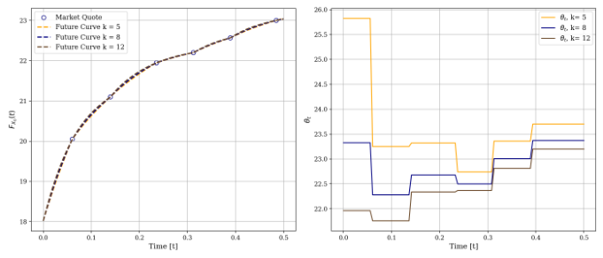

## PDF page 18 (label 18)

[Page image](../pages/page-0018.png) · [Original PDF](../original.pdf#page=18)

a positive bid and positive ask price to ensure only relevant quotes are used for the fit. Put
option prices are converted to call option prices using the put-call parity. Table 3 summarizes
the number of quotes and maximum bid-ask (implied volatility) spread [Ask] Mid _[−]_ [Bid] .

Table 3: Summary of Option Quotes and Maximum Relative Spreads

**VIX Options (Spot 18.02)**
**Maturity** **Forward** **Min Strike** **Max Strike** **Quotes** **Max % Spread**
2026-05-19 20.05 17 55.0 37 18.92%
2026-06-17 21.09 16 85.0 45 20.80%
2026-07-22 21.95 16 95.0 38 16.81%
2026-08-19 22.20 16 95.5 38 19.87%
2026-09-16 22.57 16 95.5 38 21.90%
2026-10-21 23 16 95.0 38 19.18%
**SPX Options (Spot 7152.72)**
**Maturity** **Forward** **Min Strike** **Max Strike** **Quotes** **Max % Spread**
2026-05-15 7184.96 5250 7640 410 8.82%
2026-06-18 7205.15 3400 8200 494 6.82%
2026-07-17 7222.97 1800 8700 468 6.33%
2026-08-21 7244.04 1200 9200 412 6.24%
2026-09-18 7259.87 1400 9800 367 6.19%
2026-10-16 7278.60 1400 10200 304 6.06%

For the VIX futures data, we retrieve the daily settlement prices, as provided by CBOE [1].
The settlement prices roughly correspond to EOD market prices. For any expiry date not
listed, we use a linear interpolation method to determine the corresponding forward price.

_4.2. Local Volatility for VIX_

In the first part of the model calibration, we calibrate the local volatility process ( _X_ _t_ ) _t≥t_ 0 .
We employ an adaptation of Drimus and Farkas’ method [11], which we outlined in Appendix A. The forward curve consists of _M_ = 6 maturities _t_ 1 _, t_ 2 _, . . ., t_ 6, for which the forward prices _{F_ _X,t_ _m_ : 0 _≤_ _m ≤_ _M_ _}_ are listed in Table 3. We construct the forward curve
_F_ _X_ : [ _t_ 0 _, ∞_ ) such that _F_ _X_ ( _t_ 0 ) is the spot price and _F_ _X,m_ = _F_ _X_ ( _t_ _m_ ). For the parameter _k_
we use _k_ = 12. The resulting mean-reversion parameters are then derived as _θ_ 1 _, θ_ 2 _, . . ., θ_ 5 =
23 _._ 33 _,_ 22 _._ 28 _,_ 22 _._ 68 _,_ 22 _._ 5 _,_ 23 _,_ 23 _._ 37. Figure 6 shows the corresponding curve and parameters for
_θ_ _m_ for _k_ = 12 as well as _k ∈{_ 5 _,_ 8 _}_ as comparison.

Figure 6: Calibrated VIX Future curve and corresponding _θ_ _t_ on April 27, 2026. Parameter _k ∈{_ 5 _,_ 8 _,_ 12 _}_

The interpolation functions _ν_ _m_ ( _._ ) (see Appendix A, [11]) are fitted on mid market implied
volatilities. Contrary to Drimus and Farkas, we do not use a parametric form of _ν_ _m_ ( _._ ), but a

18

