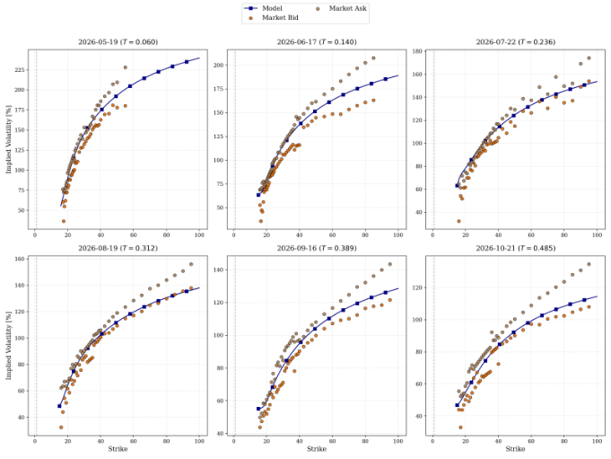

## PDF page 19 (label 19)

[Page image](../pages/page-0019.png) · [Original PDF](../original.pdf#page=19)

step-function approach as described in Appendix A. This yields a twice-differentiable option
price surface for _t ∈_ [ _t_ 0 _, t_ 6 ] and any desired strike _K_ . From the price surface we can derive
the implied volatility surface and the derivative of the implied volatility surface to compute
Equation (A.2), which is equivalent to Equation (3.4). The resulting local volatility model
after calibration replicates the smoothed VIX options market by design. We simulate Monte
Carlo paths and price model options to compare to the market quotes. Figure 7 shows that
the model fit of the options lies largely within the bid-ask spread of the VIX options.

Figure 7: VIX Options Model to Market Fit.

_4.3. Instantaneous Variance of the SPX_

In the final step of the model calibration, we derive the coupling function _ψ_ _t_ on the interval

[ _t_ 0 _, T_ _F_ + Θ] and then fit the final parameter _ρ_ to fit the SPX option skew to the market data.
Since the calibration uses maturities up to October 2026, we choose [ _t_ 0 _, T_ _F_ + Θ] = [0 _,_ 0 _._ 5].
For the terminal curve, we derive a second-order polynomial _p ∈P_ 2 from the numerically
computed values for _M_ [¯] _T_ [1] _F_ [and][ ¯] _M_ _T_ [2] _F_ [. We find] _[ p]_ [(] _[x]_ [) =] _[ a]_ [0] [ +] _[ a]_ [1] _[x]_ [ +] _[ a]_ [2] _[x]_ [2] [ with]

_a_ 2 _≈_ 1 _._ 16 _, a_ 1 _≈−_ 4 _._ 19 _, a_ 0 _≈−_ 101 _._ 37 _._

We then derive the coupling function _ψ_ on the entire interval [ _t_ 0 _, T_ _F_ + Θ] with the backward
equation (2.8), repeatedly solving the conditional expectation using a numerical PDE solver.
To empirically validate the consistency on the entire interval, we analyze the scatter plot for the
nonparametric consistency analysis of Procedure 1. Figure 8 shows that the coupling function
produces consistency across two arbitrarily selected times.

19

